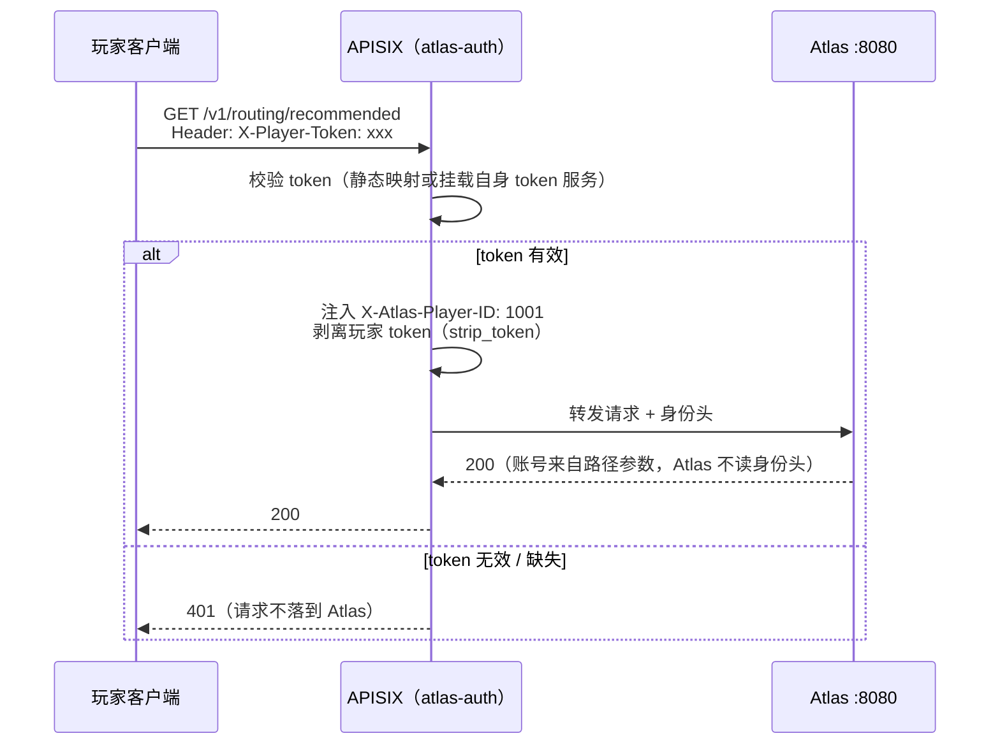

# APISIX Integration Plugins

**When to use this**: Atlas is deployed behind an APISIX gateway (the public-internet form of [Deployment Topology](/topology)),
and player clients uniformly reach :8080's Discovery / Directory / Routing through the gateway domain. Two things are easiest
to do at the gateway, with zero changes to Atlas or the game servers:

- **Player authentication**: the client's token is validated at the gateway and only forwarded to Atlas after it passes (optionally stripping
  the token header and injecting the identity header `X-Atlas-Player-ID` downstream at the same time) — Atlas never knows how tokens are issued or validated;
- **Differentiated rate limiting**: quotas per endpoint group (relaxed for read-heavy discovery, tightened for write-heavy directory,
  registry at 50 per minute against abuse), with one route covering the entire `/v1` surface.



Atlas officially ships two APISIX gateway plugins (source and unit tests in
[`plugins/apisix/`](https://github.com/cuihairu/atlas/tree/main/plugins/apisix)),
responsible for **player identity injection** and **per-endpoint-group rate limiting** respectively:

| Plugin | Responsibility |
| --- | --- |
| `atlas-auth.lua` | Validates the player token and injects the player identity into Atlas request headers (`X-Atlas-Player-ID`); optionally strips the player token before forwarding |
| `atlas-ratelimit.lua` | Differentiated rate limiting by Atlas endpoint group (discovery / directory / routing / registry); a single route covers the entire `/v1` surface |

The plugin-Atlas boundary matches [Architecture Design](/architecture): authentication and rate limiting are generic gateway capabilities
owned by APISIX; Atlas does not re-validate tokens, and currently does not read the injected identity header either (see trust rule 2 below).

**Identity header trust rules (security baseline):**

1. **The gateway overwrites; client pass-through is never trusted.** Whether or not the client carries its own `X-Atlas-Player-ID` /
   `X-Player-Token`, the gateway must first **strip, then inject** (`atlas-auth` is implemented exactly this way:
   the identity header is rewritten after token validation passes, so any same-named header sent by the client is always overwritten).
   Re-stamp based on the trusted gateway rather than "inject only if empty" — the identity header seen downstream can only come from the gateway.
2. **Atlas currently does not read the identity header.** `X-Atlas-Player-ID` is reserved metadata the gateway injects for downstream;
   Atlas's account dimension always comes from explicit request parameters (paths like `/v1/directory/accounts/{id}/characters`,
   or the `account_id` in the character-creation body), so the identity header is not an authentication input for Atlas — forged or not,
   it does not change Atlas behavior. Its consumers are other upstream services behind the gateway (or a future Atlas version). The admin plane
   (:8082 API Key + RBAC) and the registry plane (:8081 Service Token, with
   [mTLS](/security) support) authenticate independently and have nothing to do with the player identity header — even if the gateway is breached,
   a forged player identity header cannot reach the internal ports.
3. **Internal service calls should prefer mTLS / signed identity** (registry already supports mTLS; see
   [Security Model](/security)) rather than relying on bare headers as service identity.

## Installation

1. Copy the two `.lua` files into the APISIX plugin search path (by default `apisix/plugins/`, or a custom
   directory via `APISIX_CUSTOM_PLUGINS` / `lua_module_hook`):

   ```bash
   cp atlas-auth.lua atlas-ratelimit.lua /usr/local/apisix/apisix/plugins/
   ```

2. Enable the plugins in the APISIX `config.yaml` and declare the rate-limiting shared dict:

   ```yaml
   plugins:
     - atlas-auth          # 加到现有插件列表
     - atlas-ratelimit

   nginx_config:
     http:
       shared_dicts:
         - atlas_ratelimit: 10m
   ```

3. Reload APISIX: `apisix reload`.

## Route configuration

A single route forwards the whole of `/v1` to Atlas's public port (:8080), with the two plugins handling
authentication and rate limiting respectively. The complete example is
[`config-example.yaml`](https://github.com/cuihairu/atlas/blob/main/plugins/apisix/config-example.yaml),
creatable in one shot via the Admin API:

```bash
curl http://127.0.0.1:9180/apisix/admin/routes/atlas -X PUT \
  -H "X-API-KEY: $ADMIN_KEY" -d @config-example.yaml
```

The equivalent route JSON:

```yaml
uri: /v1/*
upstream:
  nodes: { "atlas:8080": 1 }
plugins:
  atlas-auth:
    token_header: X-Player-Token
    account_header: X-Atlas-Player-ID
    required: true
    strip_token: true
    accounts:
      demo-token-alice: 1001
  atlas-ratelimit:
    groups:
      - { prefix: /v1/routing,   rate: 1000, window: 60 }
      - { prefix: /v1/discovery, rate: 600,  window: 60 }
      - { prefix: /v1/directory, rate: 300,  window: 60 }
      - { prefix: /v1/registry,  rate: 50,   window: 60 }
    default_rate: 0
    rejected_code: 429
```

## Configuration reference

### atlas-auth

| Key | Default | Description |
| --- | --- | --- |
| `token_header` | `X-Player-Token` | Player token header; `Authorization: Bearer <token>` is also accepted |
| `account_header` | `X-Atlas-Player-ID` | Identity header injected for Atlas — **strip the same-named inbound header carried by the client before injecting** (overwrite rather than pass-through; see the trust rules above) |
| `accounts` | — | Static token → account id mapping; in production, replace with your own token service's validation (the plugin provides the hook point, with no business intrusion) |
| `required` | `true` | Missing token / unknown token returns 401; with `false`, anonymous requests pass (Directory browse-style endpoints) |
| `strip_token` | `false` | Strip the player token header before forwarding |

### atlas-ratelimit

| Key | Default | Description |
| --- | --- | --- |
| `groups` | `[]` | `{prefix, rate, window}` array; **longest-prefix match**, fixed-window counting |
| `default_rate` | `0` | Fallback quota for unmatched groups (0 = unlimited) |
| `rejected_code` | `429` | Status code returned when the limit is exceeded |

Count key = group prefix + client IP; if the shared dict is missing, it **fails open** and logs an ERROR,
so a rate-limiting failure never blocks the gateway.

## Verification

```bash
# 鉴权：无 token → 401；有效 token → 200
curl -i http://127.0.0.1:9080/v1/directory/accounts/1001/characters
curl -i -H "X-Player-Token: demo-token-alice" \
  http://127.0.0.1:9080/v1/directory/accounts/1001/characters

# 命中限流组：快速打满 discovery 配额，观察 429
for i in $(seq 1 700); do
  curl -s -o /dev/null -w "%{http_code} " -H "X-Player-Token: demo-token-alice" \
    http://127.0.0.1:9080/v1/discovery/servers
done
```

## Testing

The plugin logic can be tested without OpenResty (mock `apisix.core` / `ngx`):

```bash
cd plugins/apisix
lua test/run_tests.lua     # 13 例：注入/401/Bearer/剥离/限流组/最长前缀/失败放行
luac -p *.lua test/*.lua   # 语法检查
```

## Relationship to the three-port topology

APISIX acts as the public-internet entry reverse-proxying Atlas's public port (:8080); see
[Deployment Topology](/topology). Registry (:8081) and Admin (:8082) are internal service ports,
not mounted on public routes; the Registry heartbeat fan-in LB uses HAProxy TCP mode
([`deploy/haproxy/haproxy.cfg`](https://github.com/cuihairu/atlas/blob/main/deploy/haproxy/haproxy.cfg)),
and the high-availability form is covered in [High Availability](/ha).
