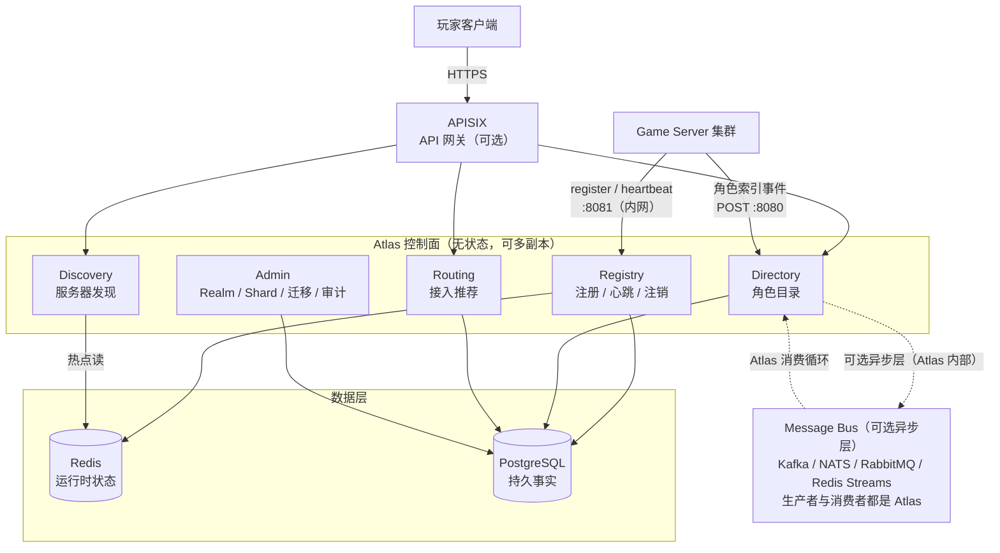
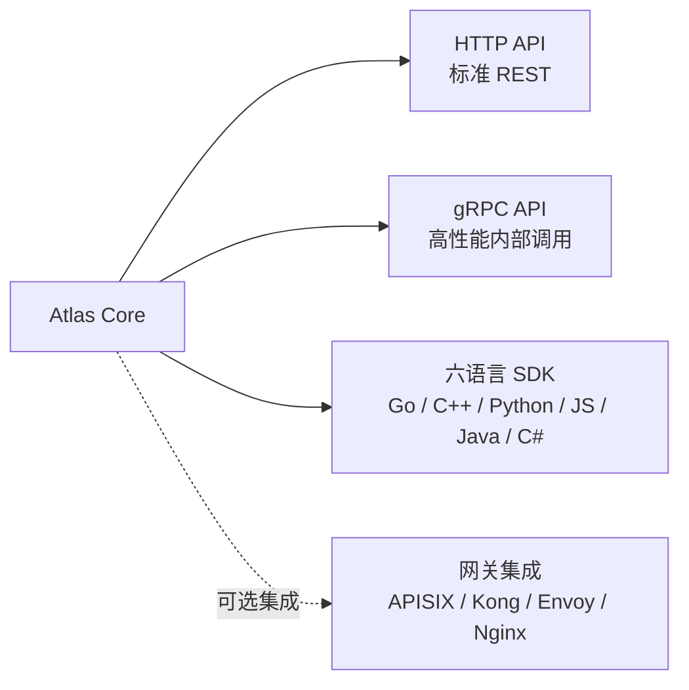
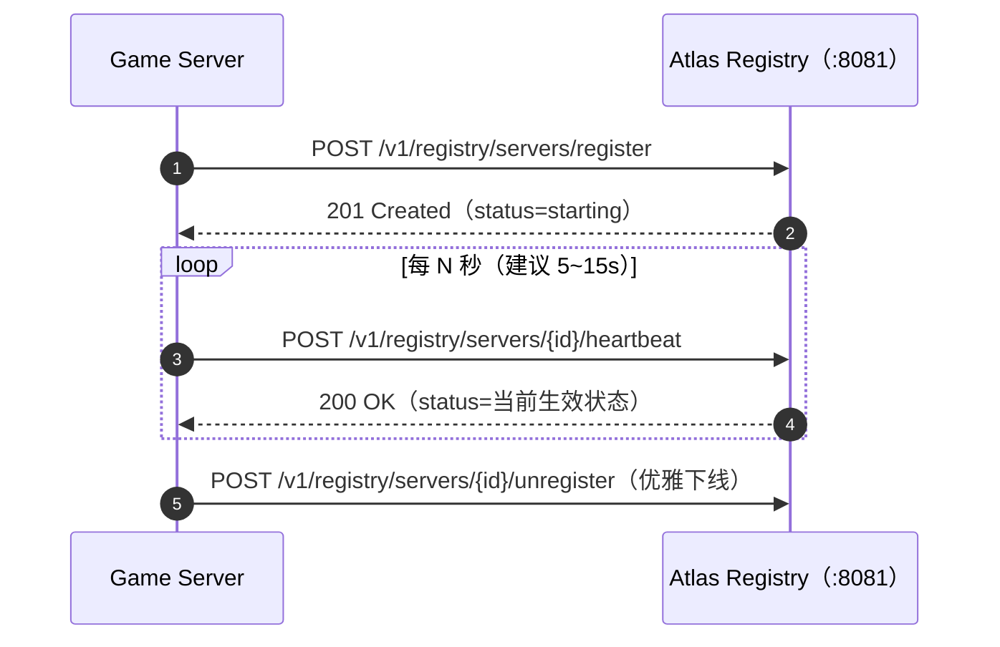
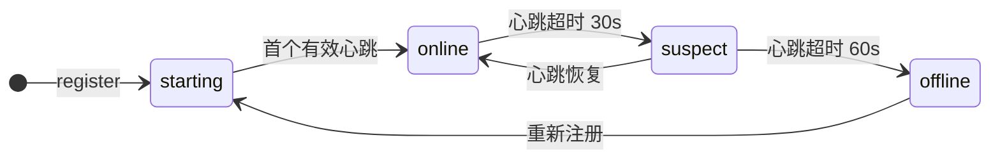
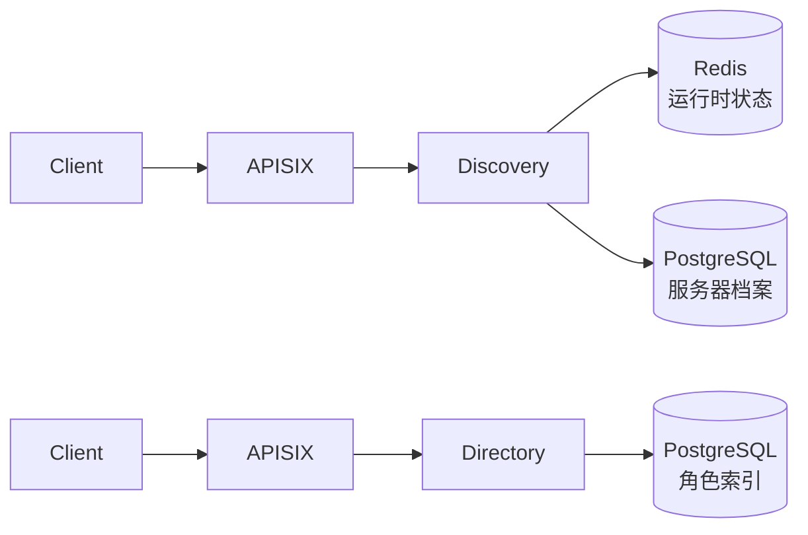
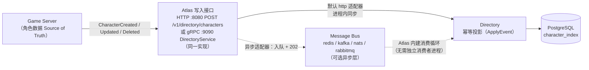
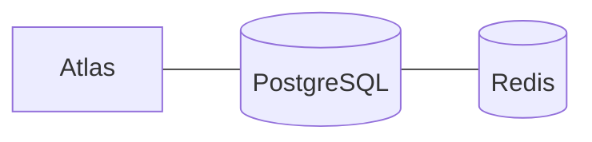
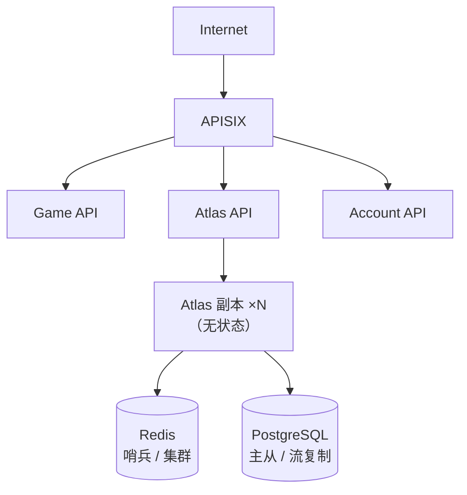

[English](architecture.en.md) | [中文](architecture.md)

<p align="center">
  
</p>

# Architecture Design

## 1. Overview

Atlas is a **Control Plane** for online games. It does not process game logic and does not store authoritative character data; it is only responsible for answering directory questions such as "where are the servers, are they available, where is the player's character".

> **Positioning statement (2026-10-04): Atlas is a game infrastructure control plane, not a game backend.**
>
> Atlas answers **directory questions**: "Who am I?" "Who is online?" "Where is my character?" "Which server should be recommended?"
> —it never answers **game runtime questions**: "Can this player enter right now?" "How is this match made?"
> "Which machine is this dungeon instance opened on?" "What is in the character's inventory?"
>
> **Atlas NEVER owns:**
>
> ```text
> ❌ 角色权威数据           —— Directory 永远是 Projection（concepts.md §7）
> ❌ 对局 / 战斗状态        —— 匹配、排队、房间、实例分配是 Scheduler 的事
> ❌ 玩家 Session          —— 登录态、会话恢复归游戏侧管理服务，不进 Atlas
> ❌ 数值 / 经济 / 排行榜    —— 背包、道具、战力、榜单是游戏业务数据库的事
> ❌ 账号认证              —— 玩家身份由网关 / 账号系统校验，Atlas 只消费身份元数据
> ```
>
> The **upstream decision authority for the above capabilities does not lie with Atlas**: they can integrate with Atlas (for example, a scheduler
> reading Discovery's candidate set), but they are **never built in**. Any new feature proposal must first answer:
> "Is this a directory question or a runtime question?"—runtime questions never come in.



---

## 2. Layered Responsibilities

| Layer | Component | Responsibility |
| --- | --- | --- |
| Access layer | APISIX | TLS termination, authentication and authorization, rate limiting, routing, load balancing, WAF, observability |
| Service layer | Atlas Core | The four major modules Registry / Discovery / Directory / Routing. Routing only does **recommendation / location metadata**, not scheduling execution (boundary statement in §1) |
| Data layer | Redis | Observed runtime state: heartbeat, load, online count (liveness basis is `last_seen_at`) |
| Data layer | PostgreSQL | Persistent facts + Effective state: server profiles, topology, character index, migration records (`servers.status` is a composite result, see §4.4) |
| Source layer | Game Server | The Source of Truth for character data; delivers index events through Atlas's write interface (HTTP `:8080` POST `/v1/directory/characters`, or gRPC `:9090` `DirectoryService`, the same implementation); does not connect directly to the message queue |

---

## 3. Boundary with the Gateway

**Core principle: Atlas is a standalone service, and the gateway is an optional access layer.**

### What APISIX handles

TLS termination, authentication and authorization, rate limiting, routing, load balancing, observability, WAF.

These are **generic gateway capabilities**, unrelated to game business semantics; every backend service needs them and Atlas should not reimplement them. APISIX, Kong, Envoy, and Nginx can all provide these capabilities.

### What Atlas handles

Server registration and discovery, character directory, health monitoring and lifecycle, Realm / Shard, server merge migration, access recommendation metadata.

These are **game domain semantics**; only Atlas understands "what a Realm is" and "what a server merge is".

### Why not build a gateway plugin

Making Atlas a plugin for APISIX / Kong / Envoy brings three problems:

1. **Lifecycle coupling** — A plugin runs inside the gateway worker and cannot scale, canary, or roll back independently.
2. **Limited capabilities** — A plugin struggles to hold long connections, background scheduled tasks (such as health sweeps), and independent storage connection pools.
3. **Loss of portability** — Switching to Nginx / Envoy / Traefik / direct connection would make Atlas unusable.

The correct form is:



This way Atlas can exist independently of any gateway, and the gateway is just one of many deployment forms.

---

## 4. Data Flow

### 4.1 Server Registration and Heartbeat



Atlas automatically advances the health status based on the heartbeat timestamp:



See [lifecycle.md](lifecycle.en.md) for details.

### 4.2 Client Query



Discovery is a high-frequency read path, and Redis carries the hot spot; Directory is a point lookup by `account_id`, which a PostgreSQL index is sufficient to support.

### 4.3 Character Index Sync

**The write interface is the only entry point, and the message queue segment happens inside Atlas**—game servers only call Atlas's
write interface: `POST /v1/directory/characters` on HTTP `:8080` (the same as the REST SDK) or
`DirectoryService` on gRPC `:9090` (an optional transport for the Go SDK), both the same implementation; the write handler,
after validation, hands off to the EventAdapter: by default the `http` adapter lands synchronously in-process; after switching to
`redis / kafka / nats / rabbitmq` the same interface enqueues and returns `202`, and Atlas's
**built-in consume loop** (`Subscribe` in `main.go`) retrieves the event and calls `ApplyEvent`
to land it. Both the producer and the consumer are Atlas; **game servers do not connect directly to the broker**:



Atlas only stores projections, not authoritative data. See [sync.md](sync.en.md) for details.

> The two event types `character.login` / `character.moved` are already defined and can be consumed, but the current version
> **has no built-in trigger source** (the write endpoints only produce created / updated / deleted), see the
> note in the event table of [sync.md](sync.en.md).

### 4.4 Status Semantics: Desired / Observed / Effective

As a control plane, Atlas distinguishes three kinds of status for each server, **with layered semantics that do not conflict**:

| State | Definition | Landing point |
| --- | --- | --- |
| **Desired** | Operational declaration: `maintenance` / `drain` / `disable` / `enable`; a scheduled maintenance window writes automatically when due | Admin operation → PG `servers.status` |
| **Observed** | Heartbeat observation: `starting` / `online` / `suspect` / `offline` advanced by the age of `last_seen_at` | Redis runtime HASH; written back to PG after the health monitoring sweep |
| **Effective** | The composite result advertised externally; all external views (discovery / recommendation / statistics) expose only this | PG `servers.status` |

Composite rule: **Desired takes precedence over Observed and they are never mutually exclusive**—`disabled` is never overwritten by the automatic state machine,
and during `maintenance` / `draining` a heartbeat does not pull the status back to `online`. See
[lifecycle.md §0](lifecycle.en.md#_0-状态三态-desired-observed-effective) for the complete definition, and
[data-model.md](data-model.en.md) for the storage annotation.

---

## 5. Storage Layering

A dual storage of **PostgreSQL + Redis** is used, divided by access pattern rather than by data type:

| Storage | Content carried | Access pattern |
| --- | --- | --- |
| **Redis** | Heartbeat timestamp, `status`, `load`, `players` | High-frequency writes (once per server every N seconds), high-frequency reads (list page) |
| **PostgreSQL** | `servers`, `realms`, `shards`, `character_index`, `migrations` | Low-frequency writes, transactional, requires persistence and relational queries |

### Why divide it this way

- **Heartbeats are volatile data.** After a server goes down, the exact value of the last heartbeat has no historical value; putting it in Redis with TTL-based expiry fits the semantics naturally.
- **Server profiles are facts.** Names, regions, versions, and topology ownership need persistence and auditing, so they go in PostgreSQL.
- **The character index needs transactions and foreign keys.** Server merge / server transfer produce cross-row changes, and PostgreSQL's transactional capability is a hard requirement.
- **The list page is a hot spot.** Clients fetching the server list is the highest-frequency read; this traffic goes through Redis, not PG.

### Dual-write consistency

v0.1 adopts the strategy of **PostgreSQL as the source of truth, Redis as cache**:

- The write path lands in PG first, then updates Redis.
- Runtime fields in Redis (`load` / `players` / `status`) are allowed to be briefly inconsistent, because they are themselves approximations.
- Heartbeat timeout is computed by the health monitoring sweep (default every 10s), which computes the age of `last_seen_at` and writes back to PG's `status`; the TTL on the Redis key (120s) is only for key self-cleanup and does not participate in liveness determination.

See [data-model.md](data-model.en.md) for detailed table structures and key design.

---

## 6. Deployment Forms

### Minimal deployment



4 services (atlas / migrate / postgres / redis), brought up with a single docker-compose command; migrate is a one-shot migration task that exits once done.

### Production deployment



Atlas Core is stateless and can scale horizontally; all state is in Redis and PostgreSQL.

---

## 7. Observability

The operational metrics Atlas exposes externally are recommended to cover:

| Metric | Meaning |
| --- | --- |
| `atlas_registry_servers_total{status}` | Current number of servers in each status |
| `atlas_registry_heartbeat_lag_seconds` | Heartbeat age distribution |
| `atlas_directory_characters_total` | Total character index size |
| `atlas_discovery_requests_total{filter}` | Discovery query volume and filter dimensions |
| `atlas_admin_requests_total{endpoint,status}` | Admin request volume and response codes (REST route patterns + full gRPC Admin method names, status codes per the same vocabulary) |
| `atlas_health_transitions_total{from,to}` | Lifecycle status transition volume |
| `atlas_directory_write_duration_seconds{op}` | Character directory write path latency (REST write + event projection) |
| `atlas_registry_write_duration_seconds{op}` | Registration/heartbeat/unregistration write path latency (the hottest write path; write degradation shows here first) |
| `atlas_store_queue_*` | memory store command write queue, 14 series (depth / watermark / enqueue / apply / merge / idempotent hits / backpressure degradation / flush batch and latency / distribution by type / replay ring length; the SQL backend exposes no series, same source as `/v1/admin/indexqueue/status`) |

The three HTTP listeners and the gRPC port additionally have request-level tracing: `X-Request-ID` (gRPC uses the `x-request-id` metadata) is propagated/generated and echoed, and on request completion an access log containing the request_id is recorded (except for `/healthz`, `/readyz`, `/metrics`); requests rejected by rate limiting/authentication also have an id. See docs/api.md "Request Tracing" for details. After configuring `ATLAS_OTLP_ENDPOINT`, the same request also opens an OpenTelemetry server span exported to any OTLP receiver (Jaeger / Tempo / collector), and the span attributes carry the same request id; see api.md "Distributed Tracing".

These metrics serve both capacity planning and alerting (for example, a sudden spike in the number of servers in `suspect` status).

---

## 8. Rationale for Architectural Choices

### 8.1 Gateway choice: APISIX is recommended, not a binding

Atlas is a standard HTTP REST service, and **any gateway capable of reverse proxying can be placed in front of it**:

| Gateway | Rate limiting | Dynamic routing | Observability | Notes |
| --- | --- | --- | --- | --- |
| **APISIX** | Built into plugins, millisecond-level hot updates | etcd watch, natively dynamic | Prometheus/SkyWalking | Recommended, reasons below |
| **Kong** | Built into plugins | Depends on DB or declarative | Plugin support | Mature, but weak Chinese community |
| **Envoy** | Local rate limiting or external rate limiting service | xDS protocol | Native support | Needs a control plane, heavy operations |
| **Nginx** | `limit_req` module | reload or OpenResty | Needs extra configuration | Lightest, but weak dynamic capability |
| **Caddy** | Plugins | Automatic HTTPS | Basic | Suitable for small scale |
| **No gateway** | Atlas's own middleware | — | — | Development/testing, not recommended for production |

**Atlas already has built-in basic rate limiting**—the token bucket middleware in `internal/httpapi/ratelimit.go` (longest path-prefix matching rule + per-client-IP bucket), enabled by configuring `ATLAS_RATE_LIMITS` / `ATLAS_RATE_LIMIT_DEFAULT` (landed in v0.1.17). But in production it is still recommended to put rate limiting at the gateway layer, because:
- Gateway rate limiting is outside the Atlas process, so when Atlas is overloaded the gateway can still hold the line
- The gateway can set different rate limiting policies for different routes (strict for registration, lenient for queries)
- Gateway rate limiting does not require changing Atlas code

**Specific reasons for choosing APISIX:**

1. **Dynamic routing is a hard requirement.** Game servers go up and down frequently, so the gateway must be able to update the routing table at millisecond level without a reload. APISIX's etcd watch mechanism fits naturally.
2. **Rate limiting plugins work out of the box.** The three plugins `limit-count`, `limit-req`, `limit-conn` cover all rate limiting needs of game scenarios, with no need to write your own.
3. **Active domestic community.** Complete Chinese documentation, and you can find people when you hit problems. Kong and Envoy have weaker communities domestically.
4. **Plugins can front-load generic logic.** Authentication, WAF, and logging done at the gateway layer mean Atlas does not need to reimplement them.

**But if you already have operational experience with Kong / Envoy / Nginx, just use it.** Atlas does not care what gateway is in front; it only exposes standard REST endpoints.

### 8.2 Why Atlas is a standalone service rather than a gateway plugin

This decision went through repeated weighing. The plugin model looks simpler, but has three fatal problems in game scenarios:

**1. Lifecycle coupling**

| Form | When the gateway process crashes | Consequence |
| --- | --- | --- |
| Plugin model | Atlas goes down with it | All game server registration state is lost |
| Standalone service | Atlas is unaffected | Heartbeats continue; the gateway reconnects automatically after recovery |

Game server registration and heartbeats should not be interrupted because the gateway restarts.

**2. Limited background tasks**

Atlas needs to run background tasks:
- Heartbeat timeout sweep (every 10 seconds)
- Server merge migration orchestration (may last several minutes)
- Health state machine advancement

Plugins run in a request-response model and have no native background task capability. To achieve this you would have to hack it, which is neither elegant nor reliable.

**3. Independent scaling**

| Form | Scaling behavior | Result |
| --- | --- | --- |
| Plugin model | Gateway scales to 10 replicas → Atlas logic scales to 10 copies along with it | Resource waste |
| Standalone service | Gateway scales to 10 replicas (traffic), Atlas scales to 2 replicas (registration and queries) | Each scales on demand |

The gateway's traffic peaks and Atlas's compute load are different curves; binding them together prevents independent optimization.

### 8.3 Why PostgreSQL + Redis rather than a single database

| Data characteristic | Where it goes | Reason |
| --- | --- | --- |
| Heartbeat, load, online count | Redis | High-frequency writes (per server every 10 seconds), TTL-based expiry, loss is recoverable |
| Server profiles | PostgreSQL | Low-frequency writes, need persistence and auditing |
| Character index | PostgreSQL | Server merges need cross-row transactions; Redis's transactional capability is insufficient |
| Runtime merged reads | Redis | The list/detail read path merges the PG profile with the Redis runtime (`players` / `load` / `last_seen_at`) and returns it |

**Why not do it with PostgreSQL alone?**

Technically possible—write heartbeats to PG too, and use a scheduled task to scan the `last_seen_at` field (Atlas's sweep already writes back PG status, so this scheme is self-consistent). But:
- 1000 servers × 0.1 QPS = 100 QPS of heartbeat writes; PG can handle it but it is not elegant
- Runtime values (`players` / `load`) change on every heartbeat; putting them in PG means the highest-frequency writes land on the most expensive layer
- Redis key TTL expiry is a native self-cleanup semantic; PG needs an extra cleanup task

**Why not do it with Redis alone?**

Redis is not suitable for:
- Transactional writes (cross-row changes to the character index during a server merge)
- Persistent auditing (server history, migration records)
- Complex queries (searching characters by name)

The cost of dual storage is one more component in operational complexity, but for game infrastructure at this scale, it is worth it.

### 8.4 Why Go rather than C++ / Rust

| Dimension | Go | C++ | Rust |
| --- | --- | --- | --- |
| **Development efficiency** | High, complete standard library | Low, complex build and dependency management | Medium, steep learning curve |
| **Concurrency model** | goroutine, naturally suited to heartbeat/sweep | Requires manual thread management | async/await, but heavy cognitive load |
| **Deployment** | Single binary, no dependencies | Needs runtime libraries | Single binary, no dependencies |
| **Ecosystem** | pgx, go-redis, net/http are all high quality | Requires selection, version fragmentation | Good ecosystem but few game-domain libraries |
| **Team fit** | Go is a mainstream language for game backends | The main language for game servers, but infrastructure may not use it | Non-mainstream |

Atlas is a control plane, not a data plane. Control planes prioritize development efficiency and operational simplicity, and Go's single-binary + goroutine model is the most suitable choice.

Using C++ for game servers themselves is reasonable (performance-sensitive), but Atlas is not on the hot path—it does not process game frames, does not forward combat packets, and only answers "where are the servers, where is the character". For this kind of control plane, Go is entirely sufficient.
