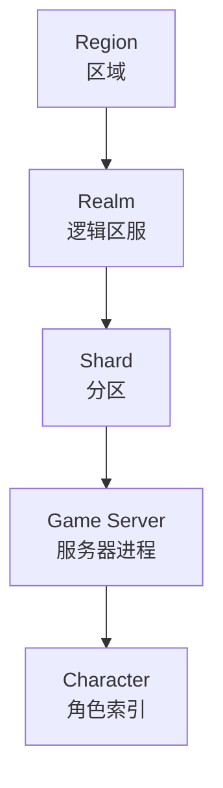
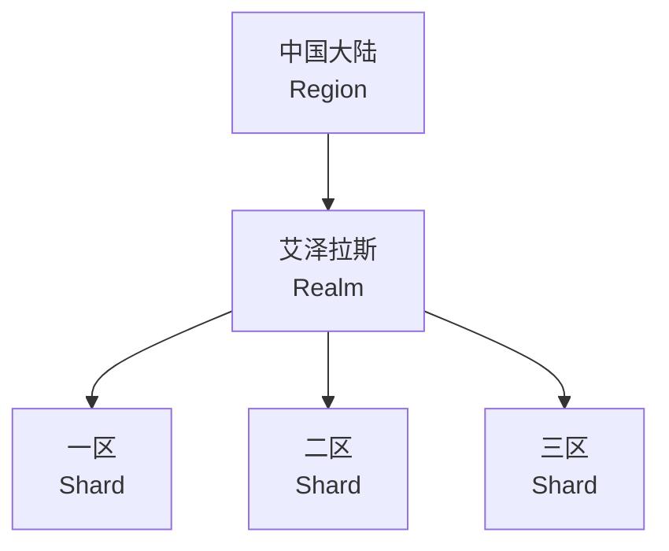
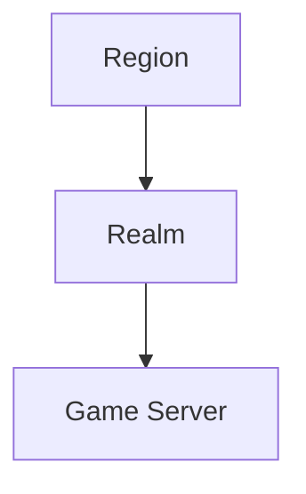
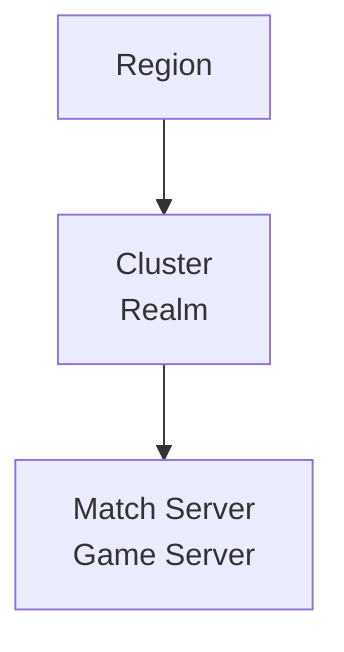
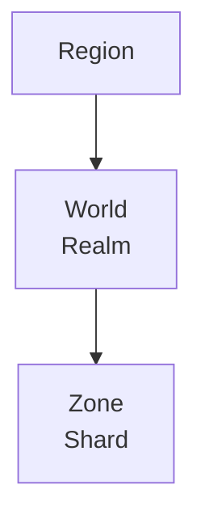
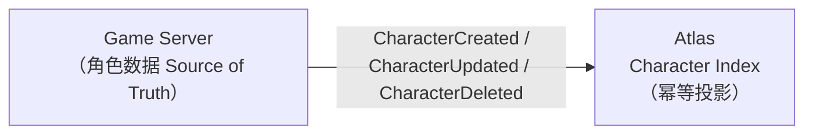

[English](concepts.md) | [简体中文](zh/concepts.md)

# Conceptual Model

This document defines the core concepts in Atlas and the relationships between them.

---

## 1. Hierarchy Overview



**Key principle: apart from `Region` and `Server`, both `Realm` and `Shard` are optional metadata.**

Atlas does not force any game to adopt a fixed hierarchy.

---

## 2. Why Make the Hierarchy Optional

Games of different genres differ enormously in their topology concepts.

### MMORPG



Or:



### MOBA



### SLG



If Atlas hard-coded the `Realm → Shard → Server` hierarchy, MOBA and SLG would be unable to use it.

The correct approach is to define `Realm` and `Shard` as **optional grouping metadata**, which games fill in according to their own semantics:

| Game type | Region | Realm | Shard | Server |
| --- | --- | --- | --- | --- |
| MMORPG | 中国大陆 | 艾泽拉斯 | 一区 | game-1001 |
| MOBA | cn-east | cluster-01 | — | match-2001 |
| SLG | cn-north | world-07 | zone-03 | zone-3003 |

Empty levels are simply omitted and occupy no conceptual space.

---

## 3. Region

Region, usually a data center locality or a compliance boundary (`cn-east`, `cn-north`, `us-west`).

- **Required** in Atlas
- Affects client latency and compliance; it is the first-priority filter condition in Routing
- **Not an independent entity**: Region has no separate CRUD; it hangs on Server and Realm as a field (`region`)

---

## 4. Realm

| Field | Type | Description |
| --- | --- | --- |
| `id` | string | Unique identifier |
| `name` | string | Display name |
| `region` | string | Owning region |
| `status` | string | Status (e.g. `active`) |
| `created_at` | time | Creation time |

Logical realm. "Azeroth" in an MMORPG, "World" in an SLG.

- **Optional**
- Multiple Servers can belong to the same Realm; during a server merge, Realm is an important aggregation dimension
- The rules for players interacting across Realms are decided by the game itself; Atlas only records the ownership

---

## 5. Shard

| Field | Type | Description |
| --- | --- | --- |
| `id` | string | Unique identifier |
| `realm_id` | string | Owning Realm, may be empty (attached directly under Region) |
| `name` | string | Display name |
| `status` | string | Status (e.g. `active`) |
| `created_at` | time | Creation time |

A partition within a Realm. "Zone 1" and "Zone 2" in an MMORPG.

- **Optional**
- `realm_id` may be empty, allowing a Shard to attach directly under Region
- The main unit of operation for server merge / server transfer

---

## 6. Server

A physical or logical game server process; it is Atlas's **core registration unit**.

| Field | Description |
| --- | --- |
| `id` | Globally unique identifier, e.g. `game-1001` |
| `name` | Display name, e.g. `一区·青龙` |
| `type` | `game` / `match` / `zone` / `login` etc., game-defined |
| `region` | Owning region, required |
| `realm_id` | Owning Realm, may be empty |
| `shard_id` | Owning Shard, may be empty |
| `version` | Game version, used for canary and version matching |
| `platform` | Platform constraint, e.g. `android` / `ios` / `pc` |
| `endpoint` | Client access address `{host, port}` |
| `status` | Lifecycle status, see [lifecycle.md](lifecycle.md) |
| `players` | Current online player count |
| `capacity` | Maximum capacity |
| `load` | Load factor, 0.0 ~ 1.0 |
| `tags` | List of operational tags, see [§Server Tags below](#服务器标记) |
| `created_at` / `updated_at` | Creation / last update time |

### Server Tags {#服务器标记}

A server can carry **multiple operational tags**; each tag has four fields:

| Field | Description |
| --- | --- |
| `code` | Tag code, `[a-z0-9][a-z0-9_-]{0,31}`, unique within the same server |
| `label` | Display text (the words shown on the badge, e.g. "Hot") |
| `tier` | Style tier: `hot` hot red / `new` new-server green / `warning` warning yellow / `info` info blue / `neutral` neutral |
| `public` | Whether it is public: only `true` appears in player-visible discovery/recommendation responses |

**Preset tags** (with built-in text and tier, `public` defaults to true): `hot` Hot, `full` Full, `no_register` Registration Forbidden, `maintenance` Under Maintenance, `new` New Server, `recommended` Recommended. Custom tags default to `public=false` (internal tags, not exposed to the frontend).

Three hard rules:

1. **Admin-exclusive maintenance**: `GET/POST /v1/admin/servers/{id}/tags`, `DELETE …/tags/{code}`. The registration upsert from game servers **omits the tags column** in SQL; re-registration/heartbeat never overwrites or clears tags—they are operational assets, not the game server's self-description.
2. **Only public tags are exposed externally**: the discovery list/detail and recommendation endpoints filter uniformly (view layer only); internal tags (such as operational notes) exist only in the admin dashboard.
3. **`no_register` is behavior, not just display**: registration control in `registry.CheckRegistration` governs both REST (`POST /v1/directory/characters` → 403 `REGISTRATION_FORBIDDEN`) and gRPC (PermissionDenied). The `maintenance` tag has the same weight as maintenance status: `ATLAS_MAINTENANCE_ENFORCE=block` (default) rejects and returns `SERVER_IN_MAINTENANCE`, `=warn` lets it through but attaches a `Warning: 299` alert header.

A real walkthrough (apply "Hot + Registration Forbidden" → player-side badge → character creation 403 → remove and recover 201) is in [Scenario Tour §2](/scenarios#scenario-tags).

---

## 7. Character

| Field | Description |
| --- | --- |
| `account_id` | Owning account (**opaque reference**, see the boundary statement below) |
| `server_id` | Server it resides on |
| `character_id` | Character unique identifier |
| `name` | Character name |
| `level` | Level (for list display, allows second-level lag) |
| `class_id` | **Deprecated** (legacy compatibility only, see the boundary statement below)—business concepts such as class go through `metadata` (e.g. `class=warrior`) |
| `avatar` | Avatar (optional) |
| `metadata` | Game-defined key-values (optional; the platform's only built-in business-semantics filtering channel) |
| `last_login_at` | Last login time |
| `created_at` / `updated_at` | Index creation / update time |

### Platform Boundary Statement (business hard-coding removal ruling, 2026-10-04)

**Class is a game business concept and is not built into the platform.** Atlas does not understand game-side classifications such as "class/sect/race"—the `class_id` field and column are retained only for legacy data compatibility (DB column retained, search parameters removed); all new integrations express this via `metadata` (`class=warrior`, `faction=horde`, `vip_level=6`…), and filtering goes through metadata key-value filtering.

**Account stance: hold only an opaque reference.** `account_id` is an int64 reference; Atlas
does not recognize phone numbers/emails/openid/unionid, does not perform account authentication, and does not integrate with any account system.
The form annotation of an account (test account/internal account/channel account) likewise goes through `metadata`
(e.g. `account_type=test`).

**Control Plane boundary (2026-10-04 positioning ruling):** Atlas answers directory questions,
not game runtime questions—the positioning statement and the NEVER-owns list are in
[architecture.md](architecture.md#_1-overview,) and the three-state model is in
[lifecycle.md](lifecycle.md#_0-three-states-desired-observed-effective.)

### The boundary of metadata: opaque metadata, not a business database

`metadata` is Atlas's only built-in business-semantics filtering channel, but its role is
**opaque metadata**:

| Allowed | Not allowed |
| --- | --- |
| Classification keys the platform can understand: `class` / `faction` / `channel` / `account_type` (static, low cardinality, used for listing/filtering) | Fields the platform makes business decisions on: `combat_power` / `guild_rank` / `arena_rating` / `dungeon_progress`… |
| Display and echo (admin list, detail, search) | Continuous tracking of numeric business attributes (Atlas does not understand them, and should not pretend to) |
| Simple key-value filtering (`metadata_key=class&metadata_value=warrior`) | Any query that depends on "the value's magnitude/ordering/range"—that is the job of the game database |

The criterion: **if a key's value changes dynamically with players/matches and the game logic depends on its semantics,
it does not belong to metadata**—that is a column of the game business database. metadata only holds
static notions at the "classification label" level. It neither grows business fields without bound nor turns Atlas into a
metadata database.

### The boundary between character ownership and location (Character vs Locator, conceptual reservation)

`character.server_id` answers **ownership**: "which server does this character belong to".
It is **not** "where is the character right now"—the two will diverge into two concepts in the future:

```text
Locator（位置，未来可能，当前不实现）
  ├── home_server     归属服务器（= 现在的 server_id）
  ├── current_server  当前所在服（跨服活动时的临时所在）
  ├── current_instance 当前实例 / 副本 / Zone
  └── session         当前会话
```

The current version **implements only the ownership layer**: `server_id` = the character's home server; during cross-server events, "where the character is right now" is held by the game-side matchmaking/matching service (see config-center.md §2.1 runtime
ID boundary), and Atlas does not track it. The `character.login` / `character.moved` events are already defined in
the event protocol (sync.md event table); if a "location layer" is needed in the future, extending the projection with the support of the event protocol will suffice, **without changing the current conceptual model**—but from today on, "ownership" and "location"
are two concepts and are no longer used interchangeably.

### The most important design principle

> **Character information in Atlas is a Projection / Index, not the Source of Truth.**



| Ownership | Data |
| --- | --- |
| **Atlas stores** | `account_id` (opaque reference), `server_id`, `character_id`, `name`, `level`, `last_login_at` (`class_id` for legacy compatibility only) |
| **Game server stores** | Equipment, inventory, quests, skills, friends, mail… all authoritative character data |

### Why it must be a Projection

1. **Responsibility boundary** — Atlas is the control plane, not the data plane. Letting the control plane hold authoritative data would make it a bottleneck and a single point of failure.
2. **Consistency responsibility** — The consistency of character data is guaranteed by the game server itself; Atlas does not intervene.
3. **Performance** — The index needs only a few redundant fields; it can be stored redundantly and updated asynchronously, without requiring strong consistency.
4. **Fault isolation** — When Atlas is unavailable, game servers keep running; only character list display temporarily fails.

### Completeness of the index

What Atlas needs to guarantee is the **completeness of the index**, i.e. "all characters under an account can be found", not "the field values are up to date". Fields such as `level` and `name` are allowed to lag (seconds to minutes), because they are used only for list display.

---

## 8. Server Migration

| Field | Description |
| --- | --- |
| `id` | Migration unique identifier |
| `source_servers` | List of source servers (a merge may have multiple sources) |
| `target_server` | Target server |
| `status` | `pending` / `migrating` / `verifying` / `completed` / `failed` / `rolled_back` |
| `started_at` | Start time |
| `completed_at` | Completion time (empty if not completed) |

Records the migration process between servers, carrying scenarios such as **server merge / server transfer / server migration / cross-region**. See [migration.md](migration.md) for details.

---

## 9. Announcement and MaintenanceWindow

These two concepts are **time-interval operational objects**—both have an effective interval, appear / switch automatically at the scheduled time, and expire automatically:

| Concept | Facing | Role | Key fields |
| --- | --- | --- | --- |
| **Announcement** | Player client | Information channel: urgent outages, maintenance notices, event schedules | `level` (info / warning / critical), global or server-level, `starts_at` / `ends_at` |
| **MaintenanceWindow** | Server status | Declarative maintenance: `start_at` automatically enters `maintenance`, `end_at` automatically restores | `previous_status` (restore target), `announcement_id` (linked announcement) |

The two can be used independently or linked: when a window is created (`announce` defaults to true) a warning announcement covering the same period is automatically generated and associated via `announcement_id`. The automatic state machine never overrides operational decisions—a window only moves the servers it placed itself.

Scenarios and drills (full curl flow, timed entry mechanism, boundary rules) are in [operations.md](operations.md); endpoint definitions are in [api.md](api.md).

---

## 10. Concept-to-API Correspondence

| Concept | API group | Description |
| --- | --- | --- |
| Server registration / heartbeat | `/v1/registry/*` | Called by game servers |
| Server query / announcement fetch | `/v1/discovery/*` | Called by clients and tools |
| Character index | `/v1/directory/*` | Queried by clients, written by game servers |
| Recommended access | `/v1/routing/*` | Called by clients |
| Lifecycle / announcement / maintenance window management | `/v1/admin/*` | Called by operational tools |

See [api.md](api.md) for the complete definition.
