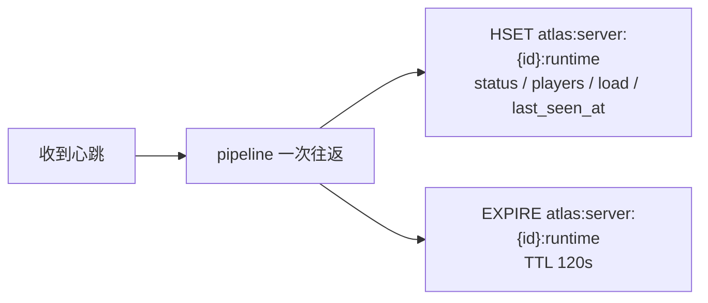
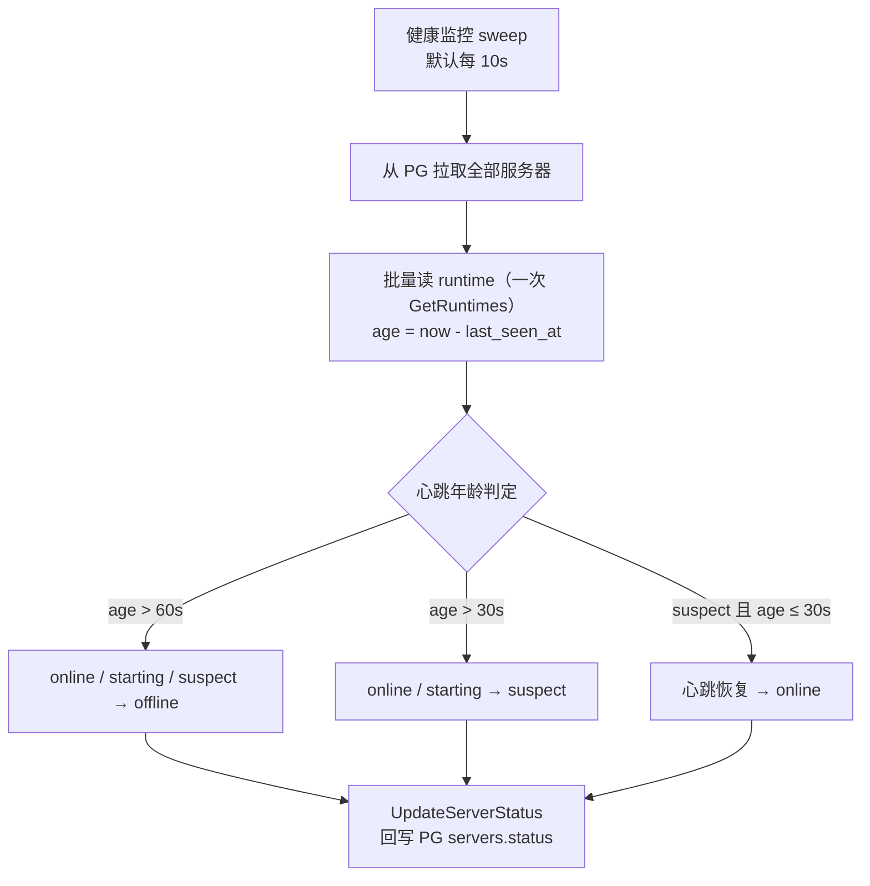
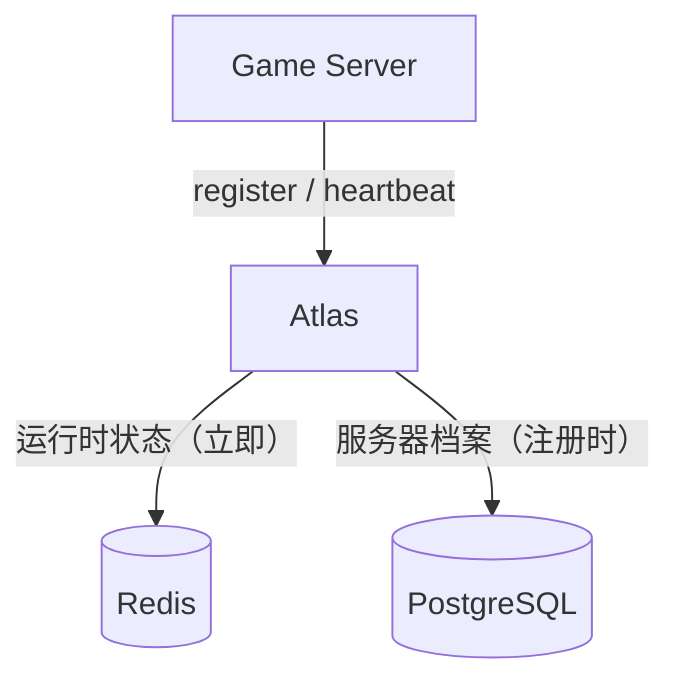
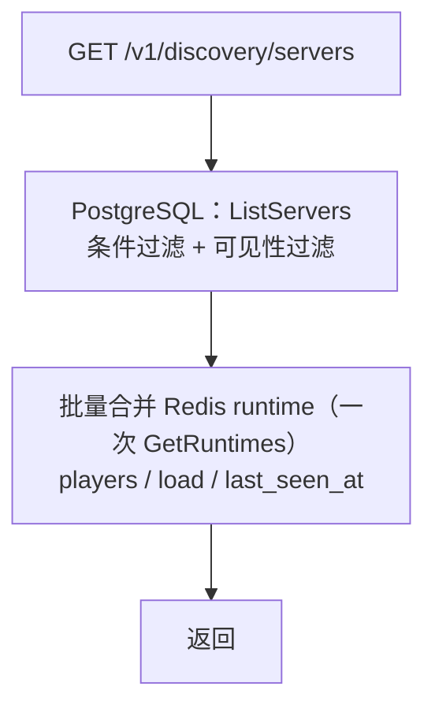
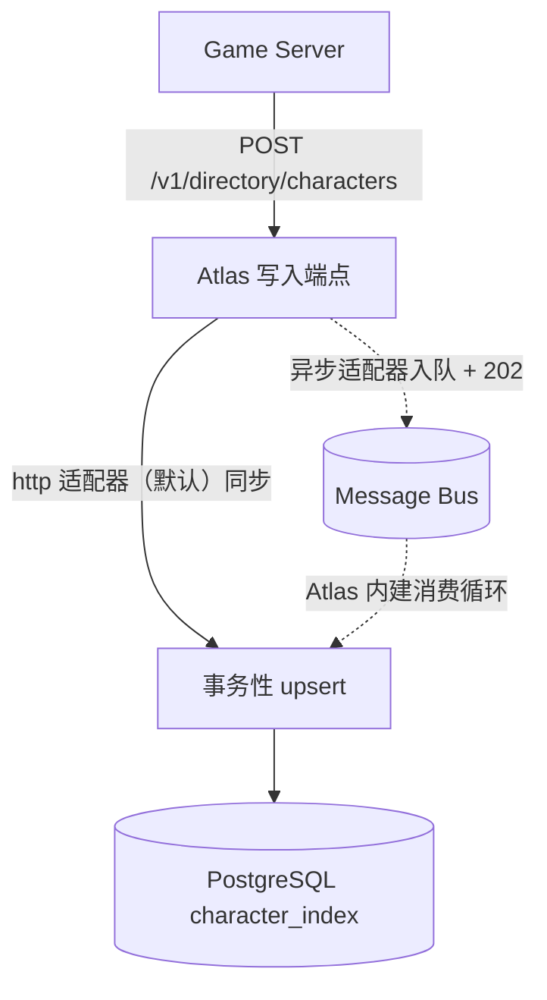
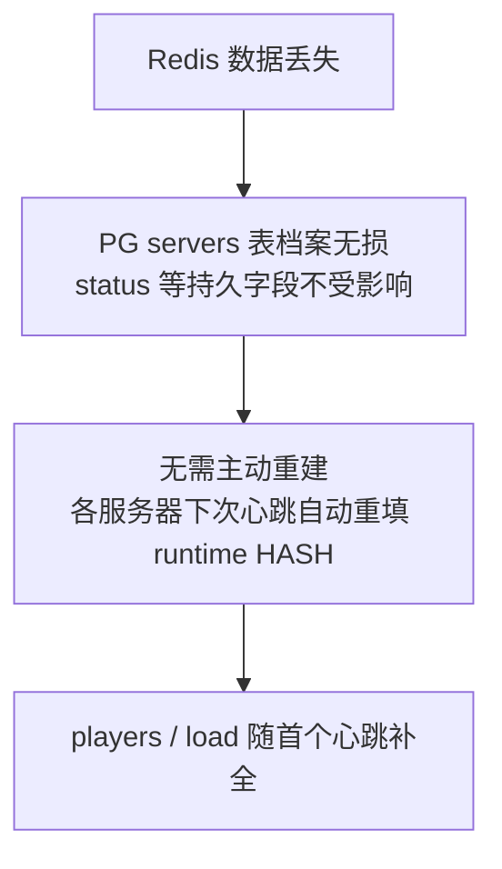

[English](data-model.en.md) | [中文](data-model.md)

# Data Model

Atlas's storage is divided into two layers by **access pattern**: persistent state such as the registry / character directory is carried by a pluggable store (`ATLAS_STORE`: `memory` by default, zero-dependency and usable out of the box; `postgres` for production; the `mysql` implementation exists but is not wired into the main program), while **runtime state** (heartbeat, player count, load, TTL ≤ 120s) always goes through Redis. This chapter gives the table structures in the production form (PostgreSQL + Redis):

| Storage | Content carried | Access pattern |
| --- | --- | --- |
| **Redis** | Heartbeat timestamp, `status`, `load`, `players` | High-frequency writes, high-frequency reads, lossy |
| **PostgreSQL** | `servers`, `realms`, `shards`, `character_index`, `migrations` | Low-frequency writes, transactional, requires persistence |

---

## 1. Why divide it this way

- **Heartbeats are volatile data.** After a server goes down, the exact value of the last heartbeat has no historical value. Redis TTL fits this semantic naturally.
- **Server profiles are facts.** Names, regions, versions, and topology ownership need persistence and auditing.
- **The character index needs transactions and foreign keys.** Server merge / server transfer produce cross-row changes, and transactional capability is a hard requirement.
- **The list page is a hot spot.** Fetching the server list is the highest-frequency read; this traffic goes through Redis, not PG.

### Consistency strategy

**PostgreSQL as the source of truth, Redis as cache.**

- The write path lands in PG first, then updates Redis.
- Runtime fields in Redis (`load` / `players` / `status`) are allowed to be briefly inconsistent; they are themselves approximations.
- Heartbeat timeout is computed by the health monitoring sweep, which computes the age of `last_seen_at` (default every 10s) and writes back to PG's `status`; the Redis key TTL (120s) is only for self-cleanup.
- When Redis is fully lost, runtime state can be rebuilt from PG (the server profiles are all there, only the heartbeat data is lost).

---

## 2. PostgreSQL Table Structures

### servers

```sql
CREATE TABLE servers (
    id          TEXT PRIMARY KEY,
    name        TEXT        NOT NULL,
    type        TEXT        NOT NULL DEFAULT 'game',
    region      TEXT        NOT NULL,
    realm_id    TEXT        REFERENCES realms(id) ON DELETE SET NULL,
    shard_id    TEXT        REFERENCES shards(id) ON DELETE SET NULL,
    version     TEXT        NOT NULL,
    platform    TEXT        NOT NULL DEFAULT '',
    endpoint_host TEXT      NOT NULL,
    endpoint_port INTEGER   NOT NULL,
    capacity    INTEGER     NOT NULL DEFAULT 0,
    metadata    JSONB       NOT NULL DEFAULT '{}',
    source      TEXT        NOT NULL DEFAULT '',
    status      TEXT        NOT NULL DEFAULT 'starting',
    started_at  TIMESTAMPTZ,
    created_at  TIMESTAMPTZ NOT NULL DEFAULT now(),
    updated_at  TIMESTAMPTZ NOT NULL DEFAULT now(),
    tags        JSONB       NOT NULL DEFAULT '[]'::jsonb,  -- migrations/0005
    notify_mode         VARCHAR(16)  NOT NULL DEFAULT '',  -- migrations/0006
    notify_callback_url VARCHAR(512) NOT NULL DEFAULT ''
);

CREATE INDEX idx_servers_region_status ON servers (region, status);
CREATE INDEX idx_servers_realm        ON servers (realm_id);
CREATE INDEX idx_servers_shard        ON servers (shard_id);
```

`tags` holds operational tags (migrations/0005, a JSONB array `{code,label,tier,public}`; the registration upsert does not touch this column); `notify_mode` / `notify_callback_url` are cross-server config change notification declarations (migrations/0006, values `subscribe` / `callback` / `poll`, see [config-center.md](config-center.md) for details).

`source` marks profile ownership (migrations/0004): `''` = API registration (default), `config` = config file declaration (`ATLAS_SERVERS_CONFIG`)—the registration API refuses to modify the profile fields of records owned by config (`409 SERVER_MANAGED_BY_CONFIG`); heartbeat and lifecycle operations proceed as usual.

The value domain of `status` is in [lifecycle.md](lifecycle.en.md):

| Status | Semantics |
| --- | --- |
| `starting` | Process starting up, not yet ready |
| `online` | Serving normally |
| `draining` | Draining (graceful shutdown) |
| `maintenance` | Under maintenance |
| `suspect` | Suspected unreachable |
| `offline` | Offline |
| `disabled` | Operationally disabled |

> **Semantic annotation (three-state model, see [lifecycle.md §0](lifecycle.en.md#_0-状态三态-desired-observed-effectiv)e)**:
> What this table's `servers.status` persists is the **Effective** state—a composite result; all external views
> (discovery / recommendation / statistics) read exactly this value, and there is no semantics conflicting with a `status` elsewhere.

`players`, `load`, and `last_seen_at` are **not in this table**; they are in Redis.

---

### realms

```sql
CREATE TABLE realms (
    id        TEXT PRIMARY KEY,
    name      TEXT        NOT NULL,
    region    TEXT        NOT NULL,
    status    TEXT        NOT NULL DEFAULT 'active',
    created_at TIMESTAMPTZ NOT NULL DEFAULT now()
);
```

---

### shards

```sql
CREATE TABLE shards (
    id        TEXT PRIMARY KEY,
    realm_id  TEXT        REFERENCES realms(id) ON DELETE SET NULL,
    name      TEXT        NOT NULL,
    status    TEXT        NOT NULL DEFAULT 'active',
    created_at TIMESTAMPTZ NOT NULL DEFAULT now()
);

CREATE INDEX idx_shards_realm ON shards (realm_id);
```

`realm_id` may be `NULL`, allowing a Shard to attach directly under Region. This is consistent with the "optional hierarchy" principle in [concepts.md](concepts.en.md).

---

### character_index

```sql
CREATE TABLE character_index (
    account_id    BIGINT      NOT NULL,
    server_id     TEXT        NOT NULL,
    character_id  BIGINT      NOT NULL,
    name          TEXT        NOT NULL,
    level         INTEGER     NOT NULL DEFAULT 1,
    class_id      INTEGER     NOT NULL DEFAULT 0,
    avatar        TEXT        NOT NULL DEFAULT '',
    metadata      JSONB       NOT NULL DEFAULT '{}',
    last_login_at TIMESTAMPTZ,
    created_at    TIMESTAMPTZ NOT NULL DEFAULT now(),
    updated_at    TIMESTAMPTZ NOT NULL DEFAULT now(),

    PRIMARY KEY (account_id, server_id, character_id)
);

CREATE INDEX idx_char_by_account ON character_index (account_id);
CREATE INDEX idx_char_by_char_id ON character_index (character_id);
CREATE INDEX idx_char_by_server  ON character_index (server_id);
```

**This is a projection table, not an authoritative data table.** The complete character data is in the game server's character database. See [concepts.md §7](concepts.en.md#7-character.)

The primary key is chosen as the `(account_id, server_id, character_id)` triple because:
- The same account can have characters on multiple servers
- The global uniqueness of `character_id` is guaranteed by the game server, but Atlas does not depend on it as the primary key, in order to tolerate ID space conflicts across different servers

`idx_char_by_char_id` is used for the reverse lookup in `GET /v1/directory/characters/{id}`.

---

### server_migrations

```sql
CREATE TABLE server_migrations (
    id             TEXT PRIMARY KEY,
    source_servers JSONB       NOT NULL DEFAULT '[]',
    target_server  TEXT        NOT NULL,
    status         TEXT        NOT NULL DEFAULT 'pending',
    started_at     TIMESTAMPTZ NOT NULL DEFAULT now(),
    completed_at   TIMESTAMPTZ
);

CREATE INDEX idx_migration_status ON server_migrations (status);
```

See [migration.md](migration.md) for details.

---

## 3. Redis Key Design

### Server runtime state

| Key | Type | Description | TTL |
| --- | --- | --- | --- |
| `atlas:server:{server_id}:runtime` | HASH | Server runtime snapshot, fields in the table below | 120 seconds, refreshed on every heartbeat |

**`atlas:server:{id}:runtime`** fields:

| Field | Example | Description |
| --- | --- | --- |
| `status` | `online` | The **observed state** reported by heartbeat (Observed side, see [lifecycle.md §0](lifecycle.en.md#_0-状态三态-desired-observed-effectiv)e); the liveness basis is `last_seen_at`, not this field |
| `players` | `843` | Current online player count (integer string) |
| `load` | `0.42` | Load ratio, a `[0, 1]` float string |
| `last_seen_at` | `2026-01-01T12:00:00Z` | The write time of the most recent heartbeat (RFC3339), the liveness basis |

The TTL is 120 seconds (`redisstore.runtimeTTL`), deliberately larger than the liveness thresholds (suspect 30s / offline 60s): key expiry is only responsible for self-cleanup of runtime data, while liveness is determined by monitoring computing the heartbeat age from `last_seen_at`.

Profile fields (`capacity`, `region`, `realm`, `shard`, `version`, `endpoint`) **do not go into Redis** and are always based on PG.

### Read paths for lists and recommendations

The current implementation has no ZSET index: both Discovery and Routing use PG as the candidate source, and Redis only supplements runtime fields.

| Read path | Implementation |
| --- | --- |
| Discovery list | PG `ListServers` (conditional filter + visibility filter) → batch read Redis `runtime` (one `GetRuntimes` pipeline, see internal/discovery/discovery.go:70) and merge `players / load / last_seen_at` |
| Routing recommendation | PG candidate set → merge runtime → score and sort: has an existing character > lowest load > largest remaining capacity > stable ID as a fallback |

### Heartbeat write path



A single heartbeat involves 2 Redis commands (`HSET` + `EXPIRE`), completed in one pipeline round trip.

### Disconnection detection



---

## 4. Data Flow

### Write path



### Read path



### Character index path



The character index does not go into Redis, because it is a point lookup by `account_id`; the PG index is sufficient to support it, and it needs transactions to guarantee cross-row consistency during a server merge.

---

## 5. Data Volume Estimation

Taking a medium-scale MMORPG as an example:

| Data | Scale | Storage |
| --- | --- | --- |
| Servers | 1,000 | PG + Redis, negligible |
| Heartbeat writes | 1,000 × 0.1 QPS = 100 QPS | Redis |
| List reads | 5,000 QPS | PG candidate set + Redis runtime merge |
| Character index | 50 million rows | PG |
| Character point lookups | 2,000 QPS | PG (via `idx_char_by_account`) |

The character index is the only table with scale pressure. The sharding infrastructure (v0.1.16) is already in place:

- **Strategy interface** `store.CharacterShardStrategy` + the default implementation `HashShardStrategy` (FNV-1a hash of `account_id` modulo the shard count, a pure function, stable across processes);
- **Sharded composition** `store/sharded` implements `CharacterStore`: reads and writes routed by `account_id` arrive in one hop; queries that cannot be routed (global `character_id` point lookup, per-server listing, Admin search) fan out to all shards and are then merged in cursor order;
- **Migration tool** `cmd/atlas-reshard` (or `sharded.Reshard`): cursor-paginated reads from the source, idempotent upsert writes to the target, supporting single-DB → N-DB and N-shard → M-shard re-splitting;
- **How to enable** `ATLAS_CHAR_SHARDS` (default 1): with a single physical DB this is logical sharding (validating the routing path); multi-DB physical splitting is supported only by the migration tool (`cmd/atlas-reshard --to-dsn`) and is not wired into the main program (same stance as MySQL).

Physical splitting (a separate PG instance per shard) is a deployment and operations decision; the interface and migration tool are already reserved for the v2.0 target, see [roadmap.md](roadmap.en.md).

---

## 6. Migration and Backup

- **PG**: conventional logical backup + WAL archiving. `character_index` can be **fully rebuilt** from the game server's character database, which is its greatest operational advantage as a projection table.
- **Redis**: no backup needed. When fully lost, runtime state is rebuilt from PG's `servers` table, at the cost of all servers needing to report one heartbeat again (usually recovered within 15 seconds).




## 7. Maintenance Windows and Announcements (v0.1.20)

Two supplementary tables (`migrations/0003_maintenance_announcements.sql`), both leaning operational with small data volume:

```sql
-- 计划维护窗口（瞬态：监控应用完毕即删除，不存历史）
CREATE TABLE maintenance_windows (
    id              TEXT PRIMARY KEY,
    server_id       TEXT NOT NULL,
    start_at        TIMESTAMPTZ NOT NULL,
    end_at          TIMESTAMPTZ NOT NULL,
    previous_status TEXT NOT NULL DEFAULT '',   -- 应用后记录恢复目标；'' = 无需恢复
    announcement_id TEXT,                       -- 关联的自动公告
    created_at      TIMESTAMPTZ NOT NULL DEFAULT now()
);

-- 客户端公告（server_id NULL = 全局）
CREATE TABLE announcements (
    id         TEXT PRIMARY KEY,
    server_id  TEXT,
    title      TEXT NOT NULL,
    body       TEXT NOT NULL DEFAULT '',
    level      TEXT NOT NULL DEFAULT 'info',    -- info | warning | critical
    starts_at  TIMESTAMPTZ NOT NULL,
    ends_at    TIMESTAMPTZ NOT NULL,
    created_at TIMESTAMPTZ NOT NULL DEFAULT now()
);

-- migrations/0002 + 0003 的索引
CREATE INDEX idx_realms_created          ON realms (created_at DESC);
CREATE INDEX idx_realms_status           ON realms (status);
CREATE INDEX idx_shards_created          ON shards (created_at DESC);
CREATE INDEX idx_shards_status           ON shards (status);
CREATE INDEX idx_maintenance_windows_server ON maintenance_windows (server_id);
CREATE INDEX idx_maintenance_windows_start  ON maintenance_windows (start_at);
CREATE INDEX idx_announcements_server     ON announcements (server_id);
CREATE INDEX idx_announcements_window     ON announcements (starts_at, ends_at);
```

Key points:

- **Windows are transient**: health monitoring restores the status after the window ends and `DELETE`s the row; the table only ever contains windows that are "not yet started / in progress"; announcements, by contrast, are persistent records.
- **`servers.started_at`** (a column added in 0003): the process start time reported at registration, refreshed on re-registration; carried in the Discovery response and used to display uptime.
- The announcement time interval is a **half-open interval** `[starts_at, ends_at)`, consistent with the maintenance window's determination.
