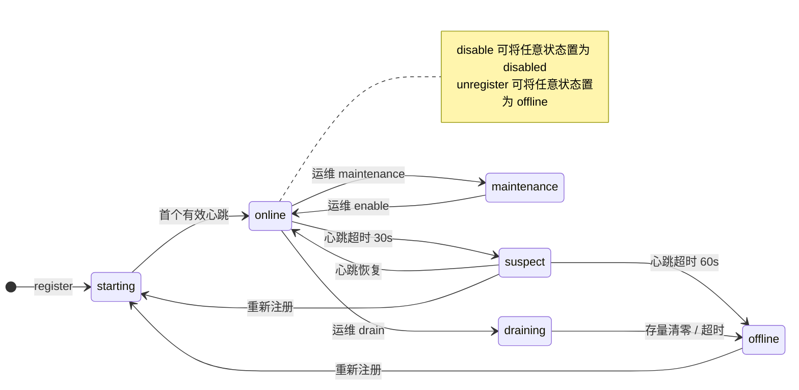
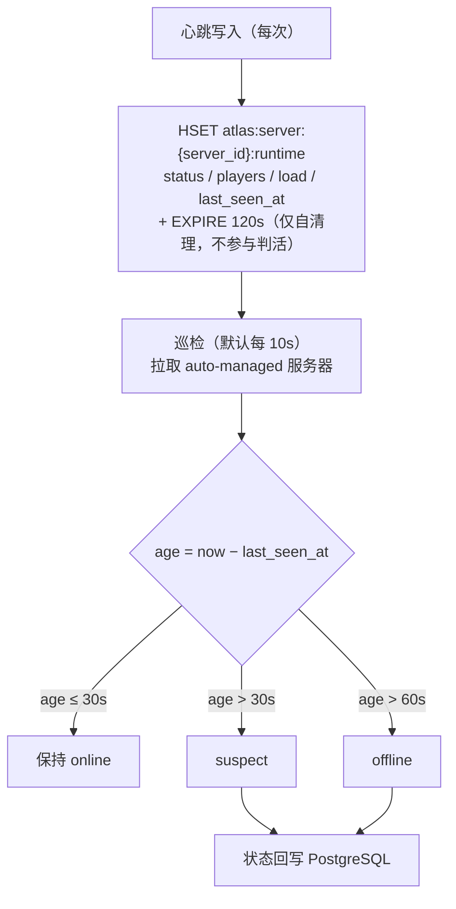

[English](lifecycle.md) | [简体中文](zh/lifecycle.md)

# Server Lifecycle

A server is not simply `online / offline`; it should have a complete lifecycle. This matters especially for large games.

---

## 0. Three States: Desired / Observed / Effective

As a control plane, Atlas distinguishes **three kinds of status** for each server, with layered semantics that do not substitute for each other:

| State | Definition | Source | Production correspondence |
| --- | --- | --- | --- |
| **Desired** | The intent declared by operations: what state this server should be in | Operational actions (`maintenance` / `drain` / `disable` / `enable`) and scheduled maintenance windows | The state machine's `draining` / `maintenance` / `disabled` |
| **Observed** | The fact observed from heartbeats: is this server alive, what is its load | Game server heartbeat + health monitoring judging by the age of `last_seen_at` | The state machine's `starting` / `online` / `suspect` / `offline` |
| **Effective** | The status advertised externally: what clients / discovery / recommendation / statistics actually see | The composite result of Desired ⊕ Observed, persisted in `servers.status` | The `status` exposed by all external views |

**Composite rules**:

1. **Operational intent takes precedence over observation**—`disabled` is never overwritten by the automatic state machine; during `maintenance` / `draining` a new heartbeat does not pull the server back to `online` (automatic status transitions act only on the auto-managed states that operations has not fenced; see §4).
2. **Observation only advances the "monitoring-takeover" set**—`starting / online / suspect / offline` are driven by heartbeat age; operationally set states do not participate in automatic transitions (the alert denominator in §4.1 is exactly this set).
3. **The three states coexist and are not mutually exclusive**—the same server can simultaneously be "desired maintenance + observed online + effective maintenance"; externally only one status, **Effective**, is ever exposed, and there is no semantics of "two statuses fighting" (see the storage annotation in data-model.md).

> **Why the three states are fixed in writing**: half of a control plane is "declaration" (Desired) and half is "observation" (Observed); the composite of the two is what players actually see (Effective). Without naming this model, a future "status looks like this in PG, status looks like that in Redis" would become an irreconcilable contradiction—in fact they belong to different layers and should each speak its own language.

---

## 1. State Machine



The complete status set:

| Status | Meaning | Client-visible | Accepts new connections | Existing players |
| --- | --- | --- | --- | --- |
| `starting` | Process starting up, not yet ready | No | No | — |
| `online` | Serving normally | Yes | Yes | Normal |
| `draining` | Draining | No | No | Normal |
| `maintenance` | Under maintenance | Yes (marked as maintaining) | No | Normal |
| `suspect` | Suspected unreachable | Yes (marked as abnormal) | Yes | Normal |
| `offline` | Offline | No | No | — |
| `disabled` | Operationally disabled | No | No | Forcefully disconnected |

---

## 2. Status Details

### STARTING

The server process has started and is loading resources, connecting dependencies, and warming caches.

- Entered by a `register` trigger
- Once ready, the game server explicitly reports `status: online`, or Atlas promotes it automatically based on the first valid heartbeat
- **Not visible externally**, preventing clients from connecting to a server that is not yet ready

### ONLINE

The normal serving state. The only state that is both "client-visible + accepting new connections".

### DRAINING

The draining state, used for **graceful shutdown**: `ONLINE → DRAINING → OFFLINE`.

- Stops accepting new connections
- **Existing players are unaffected** and keep playing until they exit on their own
- Waits for players to leave naturally or for the timeout threshold to be reached, then transitions to `OFFLINE`
- Usually used for shrinking capacity before a version update, or instance replacement

### MAINTENANCE

The maintenance state: `ONLINE → MAINTENANCE`.

**Key difference from DRAINING**: during `MAINTENANCE` **veteran players can keep playing**; only new players cannot enter.

- The client's server-selection screen shows an "under maintenance" marker instead of hiding the server
- Applicable to: temporary fault investigation, database changes, hot fixes
- After maintenance completes, transitions back to `ONLINE`

### SUSPECT

Suspected unreachable: `online → (heartbeat timeout) → suspect → (timeout without recovery) → offline`.

- Heartbeat timed out but death is not yet confirmed
- **Still visible externally**, because it may be network jitter rather than a server crash
- The client will see a prompt like "unstable connection"
- After exceeding the second-stage threshold, transitions to `OFFLINE`

The meaning of the two-stage design: avoid removing a server from the list because of a single instance of network jitter, which would cause clients to refresh the list frequently.

### OFFLINE

Offline. Invisible and does not accept connections.

### DISABLED

Operationally disabled. The difference from `OFFLINE` is that this is an **explicit manual action**; `enable` is required to restore it, and it is never overwritten by the automatic state machine.

---

## 3. Status Transition Triggers

| Transition | Triggered by | Description |
| --- | --- | --- |
| — → `starting` | Game server | `register` |
| `starting` → `online` | Game server / Atlas | First valid heartbeat |
| `online` → `draining` | Operations | `POST /v1/admin/servers/{id}/drain` |
| `online` → `maintenance` | Operations | `POST /v1/admin/servers/{id}/maintenance` |
| `online` → `suspect` | Atlas | Heartbeat timeout threshold 1 |
| `suspect` → `online` | Atlas | Heartbeat received (recovery) |
| `suspect` → `offline` | Atlas | Heartbeat timeout threshold 2 |
| `suspect` / `offline` → `starting` | Game server | Re-`register` (idempotent; only `suspect` / `offline` are reset; `online` and operationally set states are unaffected by repeated registration) |
| `draining` → `offline` | Atlas / game server | Existing players reach zero or timeout |
| `maintenance` → `online` | Operations | `POST /v1/admin/servers/{id}/enable` |
| Any → `disabled` | Operations | `POST /v1/admin/servers/{id}/disable` |
| Any → `offline` | Game server | `unregister` |

### 3.1 Registration lifecycle: permanent / temporary

Registration falls into two classes, explicitly marked by the `reg_kind` of the registration request (delivered 2026-10-14):

| Class | Marker | Deletion path |
| --- | --- | --- |
| Permanent registration | `reg_kind = "permanent"` (the default, including all legacy records) | **Does not expire automatically**; can only be deleted explicitly via `DELETE /v1/admin/servers/{id}` |
| Temporary registration | `reg_kind = "temporary"` + `ttl_seconds > 0` | **Expires automatically**: the health monitoring sweep reclaims records that have exceeded their lifetime |

- The marker is **explicit**, not inferred from "whether there is a TTL": the auto-expiry path takes effect only for `reg_kind = "temporary"`; records with an empty value / permanent marker are **never automatically cleaned under any circumstances**—including rows where a residual TTL was written bypassing validation.
- The lifetime of a temporary registration is an **absolute duration**: `ttl_seconds` counted from the moment of registration (`created_at`), independent of heartbeats (no need to read runtime data, identical behavior across the three stores). On expiry the record and its runtime data are reclaimed together.
- Re-`register` wholesale replaces the lifecycle class (same semantics as metadata): a re-registration that omits `reg_kind` returns to permanent, and the previous lifetime is discarded with it.
- `unregister` does not delete the record (only sets `offline`), for both registration classes; `DELETE /v1/admin/servers/{id}` is the only explicit deletion entry point, and config-declared servers (source=config) refuse deletion—modify the servers config file instead.

---

## 4. Automatic Disconnection Determination

Each heartbeat writes the runtime snapshot (`status` / `players` / `load` / `last_seen_at`) into the runtime HASH in Redis; the health monitoring's sweep loop (default every 10s, the same loop that applies maintenance windows) fetches all auto-managed servers, computes the **heartbeat age** and advances the status:



> The TTL (120s) is larger than the liveness thresholds, deliberately so: Redis key expiry is only responsible for "the runtime data of a completely unreachable server disappearing automatically"; life-and-death determination is always based on the age of `last_seen_at`, avoiding the two layers of semantics fighting.

Threshold recommendations:

| Parameter | Default | Description |
| --- | --- | --- |
| Heartbeat interval | 10s | Game server reporting frequency |
| runtime HASH TTL | 120s | Fixed value, key self-cleanup only; refreshed on every heartbeat |
| suspect threshold | 30s | 3× heartbeat interval (see §4.2) |
| offline threshold | 60s | 6× heartbeat interval |

Thresholds should be configurable; different deployment environments (same data center vs cross-region) differ considerably. For servers that have never reported a heartbeat (no runtime data): only the `starting` status participates in age-based death determination—counted from `CreatedAt`, and beyond the offline threshold it is **set directly to `offline` (without passing through suspect)**; the other statuses do not participate in this sweep (`maintenance` / `disabled` etc. are managed explicitly by operations).

### 4.1 Health Alerting (delivered in v0.1.15)

**When to use it**: with a fleet of dozens or hundreds of servers, watching `GET /v1/admin/stats` manually will not reveal "a batch of servers quietly went down in the middle of the night". Health alerting lets Atlas's sweep conveniently perform a fleet-wide **ratio inspection**: when the share of unreachable (suspect) or dead (offline) servers crosses a threshold, an alert fires—pushing a JSON to your webhook (on-call bot / telephony gateway) and recording a Warn log for a log-based alerting system to pick up.

**How to configure**—three environment variables, effective at process startup:

| Environment variable | Default | Description |
| --- | --- | --- |
| `ATLAS_ALERT_SUSPECT_RATIO` | `0.3` | Fires when the suspect share ≥ this value; `0` disables |
| `ATLAS_ALERT_OFFLINE_RATIO` | `0.2` | Fires when the offline share ≥ this value; `0` disables |
| `ATLAS_ALERT_WEBHOOK_URL` | (empty) | POSTs a JSON notification when an alert fires / recovers |

**What it looks like running**—a 75-second minimal drill: two servers online, `game-1002` stops heartbeating to simulate a crash (`game-1001` keeps alive), both thresholds set to `0.5`:

```bash
ATLAS_ALERT_SUSPECT_RATIO=0.5 ATLAS_ALERT_OFFLINE_RATIO=0.5 \
ATLAS_ALERT_WEBHOOK_URL=http://127.0.0.1:9999/hook ./atlas
# 注册 game-1001 / game-1002 并心跳上线（见快速上手 §1），随后停止 game-1002 的心跳
```

After about 30 seconds, `game-1002` enters suspect due to heartbeat age; the share of 1/2 reaches the threshold, and the webhook receives the first message:

```json
{"alert":"suspect_ratio","state":"firing","count":1,"auto_managed_total":2,"ratio":0.5,"threshold":0.5,"fired_at":"2026-10-02T03:27:30Z"}
```

After about 60 seconds it ages out and turns offline: suspect falls back to 0 (sending `recovered` for `suspect_ratio`), and the offline share crosses the limit (sending `firing` for `offline_ratio`). In the same period, the Atlas log shows the three corresponding Warn entries:

```text
level=WARN msg="health alert" alert=suspect_ratio state=firing    count=1 auto_managed_total=2 ratio=0.500 threshold=0.500
level=WARN msg="health alert" alert=suspect_ratio state=recovered count=0 auto_managed_total=2 ratio=0.000 threshold=0.500
level=WARN msg="health alert" alert=offline_ratio state=firing    count=1 auto_managed_total=2 ratio=0.500 threshold=0.500
```

**Semantic key points**:

- The alert target is the "monitoring-takeover" server set—i.e. the **Observed side** of the three states in §0 (starting / online / suspect / offline); maintenance and disable are Desired states, set by operations, and do not participate in the denominator.
- **Latching semantics**: when the share crosses the limit one `firing` is sent; continued crossing afterwards **does not resend**; only when it falls back below the threshold is one `recovered` sent. No spamming.
- Webhook payload fields: `alert` (`suspect_ratio` / `offline_ratio`), `state` (`firing` / `recovered`), `count` / `auto_managed_total` (unhealthy count / denominator), `ratio` / `threshold`, `fired_at` (RFC3339 UTC).
- Webhook delivery failure only logs an error and does not affect the sweep loop.

Example webhook payload:

```json
{
  "alert": "offline_ratio",
  "state": "firing",
  "count": 5,
  "auto_managed_total": 20,
  "ratio": 0.25,
  "threshold": 0.2,
  "fired_at": "2026-10-01T12:00:00Z"
}
```

### 4.2 Heartbeat Pacing Guidance (3:1 rule, v0.1.20)

Threshold setting follows the **3:1:6 rhythm**—heartbeat interval : suspect threshold : offline threshold = 1 : 3 : 6 (default 10s / 30s / 60s):

- **3×** the heartbeat interval to enter suspect: tolerate losing two consecutive heartbeats before marking, avoiding single network jitter causing client list flicker;
- **6×** to enter offline: give the monitoring side a full suspect window to confirm, instead of declaring death outright;
- When the heartbeat interval changes, scale the thresholds proportionally (e.g. 5s heartbeat → 15s suspect / 30s offline), keeping the fault-tolerance semantics unchanged.

The larger the heartbeat interval, the slower clients perceive failover (e.g. an Atlas replica crash as in [ha.md](ha.md)); exceeding one third of the offline threshold is not recommended.

### 4.3 Registration Metadata (v0.1.20)

Two optional fields added to the registration request:

| Field | Description |
| --- | --- |
| `players` | The initial online player count at registration, written directly into the runtime data; after an Atlas restart, game servers re-registering will not report 0 |
| `started_at` | The game server process start time; defaults to the registration moment. Re-registration (process restart) refreshes it; the Discovery side can display uptime based on it |

### 4.4 Permanent-Registration Offline Alert (2026-10-14)

The ratio alert in §4.1 watches the "unreachable proportion", while a single **permanently registered** server exiting silently is also an event worth knowing immediately. When a permanently registered server is judged `offline` by the sweep (§4 thresholds), health monitoring additionally sends a **single-server alert**—still through the alerting channels of §4.1 (Warn log + `ATLAS_ALERT_WEBHOOK_URL`), without spinning up a separate notification chain:

```json
{
  "alert": "permanent_offline",
  "state": "firing",
  "server_id": "game-1002",
  "reg_kind": "permanent",
  "offline_for": "1m5s",
  "maintenance": false,
  "fired_at": "2026-10-14T03:27:30Z"
}
```

Semantic key points:

- **Exemption**: the `maintenance` status is set by operations and untouched by the sweep (§3), so servers in a maintenance state **will not produce this alert**—no spamming during maintenance windows.
- **One report per event**: a status transition happens only when the status changes; one crash corresponds to one alert; crashing again after recovery is a new transition and only then is another report sent.
- **Temporary registrations do not alert**: a temporary registration disappearing is its expected lifecycle (§3.1 expiry reclamation) and is not treated as an event.
- Boundary: offlines that occur while Atlas itself is down / restarting are not re-transitioned in the first sweep after restart (the status is already offline, no transition event); alerts for that period are backstopped by the §4.1 ratio alerts and log monitoring.

---

## 5. Scheduled Maintenance Windows (v0.1.20)

Operations can schedule maintenance periods in advance; health monitoring automatically puts the server into `maintenance` when the window opens and restores the original status when it ends:

```http
POST /v1/admin/servers/{id}/maintenance-window
{ "start_at": "...", "end_at": "...", "announce": true }
```

Application rules:

| Timing | Behavior |
| --- | --- |
| `start_at` reached | auto-managed statuses (starting / online / suspect) → `maintenance`, and the original status is recorded in the window's `previous_status` |
| `end_at` reached | If the server is still in `maintenance` (put there by the window) → restore `previous_status`, then delete the window record |
| Server is in an operator status (draining / disabled) or offline | Leave it alone; the window is marked as applied (no restore target) |
| Operations manually transitions during the window | The operational action prevails; the window does not roll back at its end |

By default (`announce` defaults to `true`) the window automatically creates an announcement covering the same period, server-scoped, at warning level and associates it with the window (see §6 and api.md). Canceling a window (DELETE) does not retract the created announcement and does not pull out servers already in maintenance.

**Recommended traffic steering (pre-maintenance steering)**: routing recommendation (`/v1/routing/recommended`) is aware of
maintenance windows—servers within the window's active period, and within `ATLAS_ROUTING_MAINTENANCE_LEAD`
(default 5 minutes) before the window starts, are no longer recommended, even if the lifecycle status is still `online` (the sweep
has not yet flipped it); recommendation resumes once the window ends (before the record is deleted). The window exclusion applies uniformly to both the strict / fallback
phases of recommendation: it would rather return `NO_SERVER_AVAILABLE` than steer players toward a server about to enter
maintenance. The diagnostic endpoint (`/v1/admin/diagnose/routing`) lays out the window determination server-by-server and attaches the window records.

---

## 6. Correspondence with the API

| Status operation | API |
| --- | --- |
| Register | `POST /v1/registry/servers/register` |
| Heartbeat | `POST /v1/registry/servers/{id}/heartbeat` |
| Voluntary shutdown | `POST /v1/registry/servers/{id}/unregister` |
| Explicit record deletion | `DELETE /v1/admin/servers/{id}` (the only deletion path for permanent registrations, §3.1) |
| Enter maintenance | `POST /v1/admin/servers/{id}/maintenance` |
| Drain | `POST /v1/admin/servers/{id}/drain` |
| Enable | `POST /v1/admin/servers/{id}/enable` |
| Disable | `POST /v1/admin/servers/{id}/disable` |
| Schedule maintenance window | `POST /v1/admin/servers/{id}/maintenance-window` |
| List maintenance windows | `GET /v1/admin/maintenance-windows` |
| Cancel maintenance window | `DELETE /v1/admin/maintenance-windows/{id}` |

See [api.md](api.md) for the complete definition.

---

## 7. Client Visibility Rules

Default behavior of the Discovery API:

| Status | Returned by default | Reason |
| --- | --- | --- |
| `online` | ✅ | Normal |
| `maintenance` | ✅ (with a marker) | Players need to know the server is under maintenance, not that it "disappeared" |
| `suspect` | ✅ (with a marker) | May be network jitter; should not be removed |
| `starting` | ❌ | Not ready |
| `draining` | ❌ | Going down; should not be entered |
| `offline` | ❌ | Dead |
| `disabled` | ❌ | Operationally disabled |

**Core principle: clients should not see servers that are already dead, but neither should they see servers "suddenly disappear".** Keeping `maintenance` and `suspect` visible with markers is the key to avoiding client list jitter.
