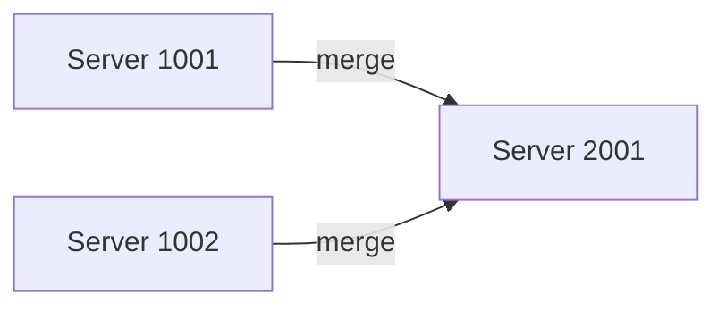
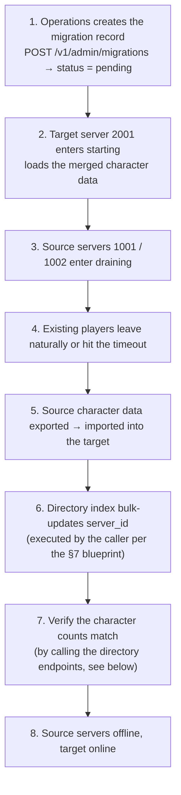
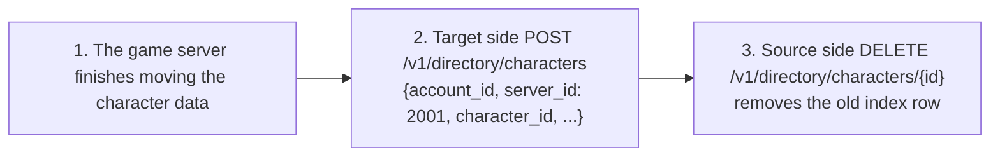
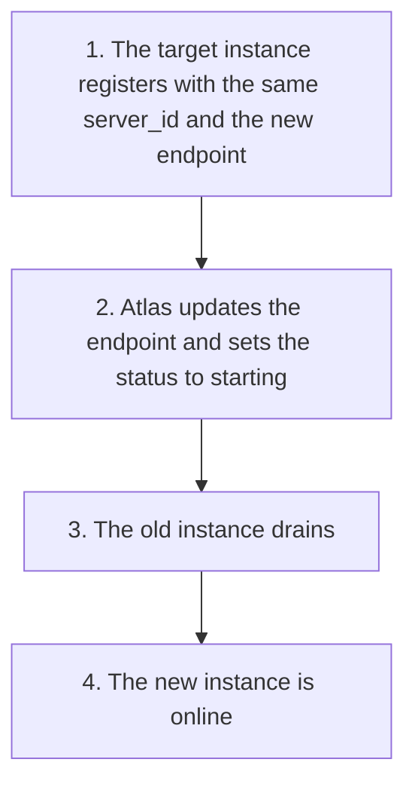
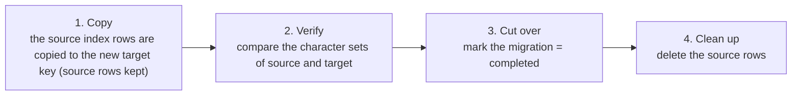
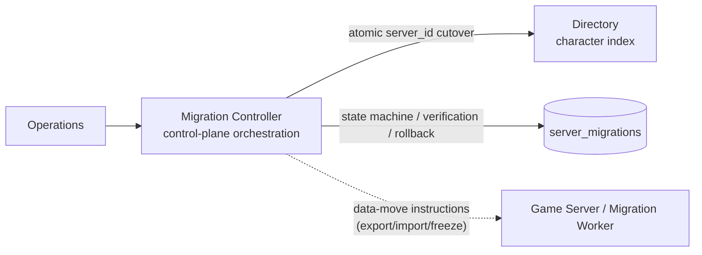

# Merge / Transfer / Migration

Atlas's character directory design makes it naturally suited to carrying character
migration between servers. This is the second big point of difference between Atlas and
an ordinary Service Discovery.

---

## 1. Scenarios

| Scenario | Meaning |
| --- | --- |
| Server merge | Several servers merge into one |
| Character transfer | A player moves a character from one server to another |
| Server migration | An entire server is relocated (new datacenter / new cluster) |
| Cross-region | Migration across Regions |

All four are abstracted in Atlas as the same thing: **the `server_id` of a character
index entry moves from source to target**.

---

## 2. Server merge



### What changes in the character directory

| Field | Value |
| --- | --- |
| `character_id` | 123 |
| `old_server` | 1001 |
| `new_server` | 2001 |

### The process



> **Status in v0.1**: step 1 is an Atlas API call (it only creates the record,
> `status = pending`); steps 2-5 and 8 are actions taken by operations and the game
> servers — Atlas takes no part in the orchestration and does **not** advance the
> migration state automatically: `migrating` / `verifying` / `completed` currently have
> no API-reachable path (the record stays at `pending`, and the only reachable state
> transition is `rollback`). The index change in step 6 has no atomic endpoint today
> (see the status note in §3); the verification in step 7 is a comparison you perform
> yourself by calling the directory endpoints. Automatic orchestration is the design
> blueprint in §7 and is not yet implemented.

### Verification

The thing most likely to go wrong in a merge is **losing characters**. Atlas provides
the verification capability for step 7:

`GET /v1/directory/servers/{server_id}/characters` (pull the character list for the
source and the target separately)

Compare the character counts and the `character_id` sets before and after the migration
to make sure:

| # | Verification condition |
| --- | --- |
| 1 | source character count == the count of characters in the target that came from the source |
| 2 | No `character_id` is missing |
| 3 | No `character_id` is duplicated |

---

## 3. Character transfer

A player actively moves a single character.

| Field | Value |
| --- | --- |
| `character_id` | 123 |
| `source_servers` | `["1001"]` |
| `target_server` | 2001 |

> Note: the API request body uses a `source_servers` array
> (`CreateMigrationRequest.SourceServers []string`); server merge, character transfer and
> server migration all share one endpoint. For a character transfer the array holds just
> the single source server.

The difference from a merge: a transfer is at **single-character granularity**, a merge
is at **server granularity**. But as far as Atlas is concerned, both are a change to the
`server_id` field in `character_index`.

> **Status in v0.1**: the Directory API has no endpoint that atomically changes
> `server_id` — `PATCH /v1/directory/characters/{id}` only accepts `name` / `level` /
> `class_id` / `avatar` / `metadata` (`server_id` is the row locator, not a mutable
> field). The workable path today is **create-new-then-delete-old**, two steps:



The two steps are **not a transaction**: creating the target row is subject to the
registration gate (it is rejected if the target is in maintenance / registration
disabled), and between the create and the delete the same `character_id` can briefly
exist on both sides. An atomic cutover endpoint is on the roadmap; moving the data
itself is always the game server's job, and what Atlas guarantees is a consistent view
of the directory and runtime state.

---

## 4. Server migration

An entire server relocates; `server_id` stays the same and `endpoint` changes.

| Server | Phase | endpoint |
| --- | --- | --- |
| `game-1001` | before | `10.0.1.21:30001` |
| `game-1001` | after | `10.0.5.88:30001` |

For Atlas this is just an update to `servers.endpoint`; the character index needs no
change.



---

## 5. Data model

### server_migrations

```sql
CREATE TABLE server_migrations (
    id             TEXT PRIMARY KEY,
    source_servers JSONB       NOT NULL DEFAULT '[]',
    target_server  TEXT        NOT NULL,
    status         TEXT        NOT NULL DEFAULT 'pending',
    started_at     TIMESTAMPTZ NOT NULL DEFAULT now(),
    completed_at   TIMESTAMPTZ
);
```

`status` values:

| status | Meaning |
| --- | --- |
| `pending` | Created, not started |
| `migrating` | In progress |
| `verifying` | Being verified |
| `completed` | Finished |
| `failed` | Failed, needs human intervention |
| `rolled_back` | Rolled back |

### Changes to character_index

A merge produces no new rows, it only updates `server_id`:

```sql
-- Merge: 1001 and 1002 are folded into 2001
UPDATE character_index
   SET server_id = '2001', updated_at = now()
 WHERE server_id IN ('1001', '1002');
```

Because the primary key is `(account_id, server_id, character_id)`, changing
`server_id` changes the primary key, so you need:

1. Insert the rows under the new key
2. Delete the rows under the old key
3. **Do both in the same transaction**

```sql
BEGIN;

INSERT INTO character_index (account_id, server_id, character_id, name, level, class_id, last_login_at)
SELECT account_id, '2001', character_id, name, level, class_id, last_login_at
  FROM character_index
 WHERE server_id = '1001';

DELETE FROM character_index WHERE server_id = '1001';

INSERT INTO server_migrations (id, source_servers, target_server, status, completed_at)
VALUES ('mig-2026-001', '["1001"]', '2001', 'completed', now());

COMMIT;
```

**This is exactly why the character index must live in PostgreSQL rather than Redis**:
cross-row transactions are a hard requirement.

---

## 6. Migration APIs

### POST /v1/admin/migrations

```json
{
  "source_servers": ["game-1001", "game-1002"],
  "target_server": "game-2001"
}
```

> The request body has only two fields, `source_servers` and `target_server`
> (`CreateMigrationRequest`). Server merge / character transfer / server migration share
> one endpoint; the semantics follow from the number and relationship of sources to
> target, so no `type` field is needed.

### GET /v1/admin/migrations/{id}

```json
{
  "id": "mig-2026-001",
  "source_servers": ["game-1001", "game-1002"],
  "target_server": "game-2001",
  "status": "pending",
  "started_at": "2026-10-01T02:00:00Z",
  "completed_at": null
}
```

> Migration records carry no `progress` (character count) field; during the migration
> you compare counts yourself using the directory queries from §2.

### POST /v1/admin/migrations/{id}/rollback

Rolls back on failure. This presumes that every step of the migration is reversible,
which is why **migrations must be idempotent and replayable**.

---

## 7. Idempotency and replay

Failing halfway through a migration is normal (network jitter, target server crash, disk
full). Atlas's design requirements for migration capability, against the v0.1 status:

| Requirement | Design | v0.1 status |
| --- | --- | --- |
| **Idempotent** | At `character_id` granularity, migrating the same character twice has no side effects | The directory write endpoint is an idempotent upsert: re-creating the same `(account_id, server_id, character_id)` is treated as an update |
| **Replayable** | Record a migration progress cursor and resume from the interruption point after a failure | Not implemented — migration records have no `progress` field |
| **Rollbackable** | Keep the source server's character index until verification passes | `POST /v1/admin/migrations/{id}/rollback` only marks the record `rolled_back` (the only reachable state transition) and performs no data action |
| **Verifiable** | Provide an endpoint to compare the character sets before and after | You compare using the directory endpoints yourself (step 7 in §2) |

The core design: **copy first, cut over second, clean up third**, rather than moving in
place.



This is a **design blueprint**: in v0.1 Atlas only provides migration records (create /
query / rollback) plus the directory write endpoint; the orchestration does not happen
automatically — every step must be executed explicitly by the caller (an operations
script or the game server). "If any step fails, the source data is still there, so you
can start over" is precisely the reason the orchestration is handed to a human at the
controls.

---

## 8. Why this belongs to Atlas

A natural question: **isn't a server merge just the game server's own business?**

No, for three reasons:

1. **It crosses servers** — a merge involves two or more servers, and no single server
   can hold the global view.
2. **The character index is Atlas's data** — `character_index` is owned by Atlas, and
   only Atlas can change `server_id` atomically.
3. **Observability** — migration progress, failure reasons and rollback records need a
   single place to present them to operations.

But mind the boundary:

| Belongs to Atlas | Belongs to the game server |
| --- | --- |
| Changing the character index's `server_id` | Moving the authoritative character data |
| Migration records and the state machine | The player's online experience during a migration |
| Verifying index integrity | Verifying character data integrity |
| Migration orchestration | The concrete data import/export |

Atlas is the **orchestrator and index holder**, not a data mover.

---

## 9. Conceptual boundary: Migration Controller vs Directory

Migration is a control-plane capability, not an accessory of the directory. The two are
always separate in **concept and in code modules**:

| | Directory | Migration Controller |
| --- | --- | --- |
| Responsibility | Querying and writing projections of the character index | The orchestration state machine for migrations (plan / status / cutover / rollback / verification) |
| Data | `character_index` rows | `server_migrations` rows |
| What it mutates | A single character's `server_id` (only the Directory may change it) | The migration record itself; when it needs to touch the index it **calls** the Directory's atomic operation |
| External shape | `GET/POST/PATCH/DELETE /v1/directory/*` | `POST /v1/admin/migrations*` (an independent resource with its own state machine) |



**The iron rule of the split**:

- Atlas (the Migration Controller) owns **who moves where, the current migration state,
  cutover, rollback and index verification** — these are control-plane responsibilities;
  the positioning statement is in [architecture.md](architecture.md#_1-overview).
- Character data replication, character freezing, database export/import and
  game-server-side state migration **belong to the Game Server / Migration Worker** —
  moving data is not Atlas's job.

In the current version the two coexist inside the Atlas process (the API layer is already
an independent resource). If they are ever split into separate modules/services, this
boundary is the rule from today onward — at minimum, "migration orchestration" and
"character index projection" must never be mashed into one package at the code level.
Across the v0.1 series, `internal/admin` (the migration service) and
`internal/directory` (the index projection) already diverge naturally; the only reason to
split them further into **independent services** is a genuine need for independent
scaling per fleet (see docs/roadmap.md).

As of 2026-10-14 this "don't mash it at the code level" baseline has landed: the
migration orchestration state machine (create / get / list / rollback) was extracted into
a standalone package `internal/migration` (with its own narrow Store interface,
independent of any concrete storage implementation), and `internal/admin` keeps only a
thin delegation (`admin.CreateMigrationRequest` is a type alias of the migration-side
DTO, so the REST/gRPC contracts are unchanged).

### 9.1 Migration-Window Linkage

Creating a migration automatically stages a maintenance window on the source servers,
which enter protection during the migration (no longer accepting new connections). The
window reuses the already-delivered batch window API
(`POST /v1/admin/maintenance-windows/batch`); no new path is added.

| Design decision | Value | Rationale |
| --- | --- | --- |
| Trigger point | After `CreateMigration` succeeds | Protection is needed the moment a migration starts; the window is written before the migration record |
| Target servers | The source servers (not the target) | The target is the destination; staging a window there is meaningless |
| Window duration | 24h (`DefaultMigrationWindowDuration`) | A migration is an open-ended record (no end time), and the window is a protection convenience — it expires on its own instead of locking the source server |
| Error semantics | fail-closed | If the window cannot be staged → the migration record is not written (a source server is never migrated away unprotected); per-server failures propagate the same way |
| Rollback handling | The window expires naturally and is not cancelled automatically | Migration records have no window ID field (no schema extension); operations can cancel manually with `DELETE /v1/admin/maintenance-windows/{id}` |
| Architectural ownership | `migration.Service` holds an optional `WindowCreator` interface | The linkage logic belongs to the migration package (state machine ordering); window creation is injected as an implementation by admin (no reverse dependency) |

Behaviour when a window cannot be staged: `CreateMigration` returns a
`create maintenance windows: ...` error and the migration record is **not written**
(fail-closed). Once operations fixes the cause, just retry.
