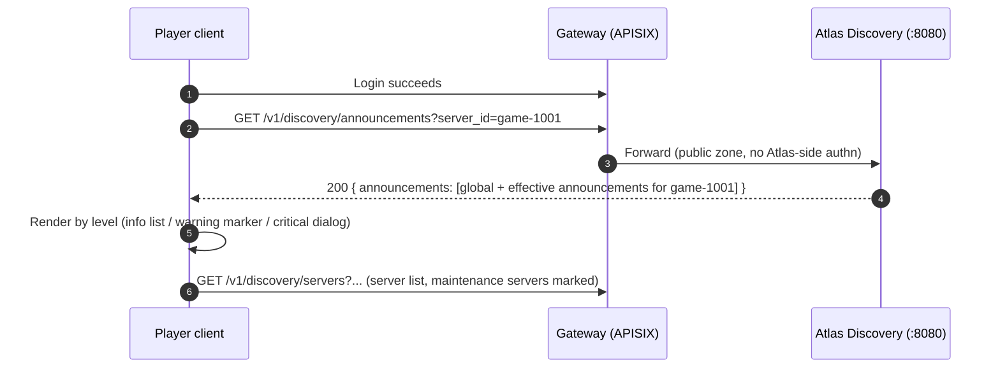
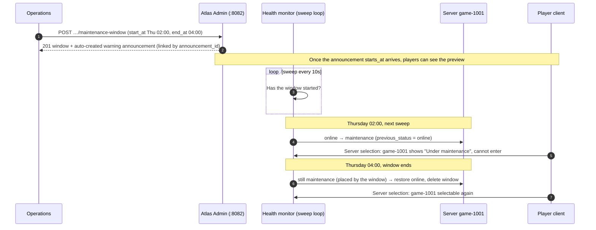

# Announcements and Planned Maintenance

Announcements and maintenance windows are the two operations-facing capabilities of
the Atlas admin plane (:8082): one delivers messages to player clients, the other
switches server state on a schedule. They can be used independently or together —
creating a maintenance window automatically generates a matching maintenance
announcement covering the same period.

---

## 1. Why they exist

| Scenario | Without Atlas | With Atlas |
| --- | --- | --- |
| **Emergency outage** | Announcements need a client hot-update, so shipping waits for players to update; with no unified channel, players keep piling into the broken server | One Admin API call publishes a `critical` announcement with `starts_at` set to now for immediate effect; clients see it on their next login when they pull `/v1/discovery/announcements` |
| **Planned downtime** | Operations sets an alarm, manually puts the server into maintenance, manually posts the announcement, and manually restores it afterwards — miss a step and it's an incident | Create the window ahead of time: at `start_at` it enters `maintenance` automatically, at `end_at` it restores automatically, and a `warning` announcement is attached for the same period |
| **Event pre-announcement** | The operations schedule and the in-game announcement are two separate systems whose times never line up | An `info` announcement plus an effective interval: create it ahead of time, it appears automatically at the start, and disappears automatically when it expires |
| **Client release window** | Old clients hit new servers and compatibility issues explode | A maintenance window plus an announcement telling players to update; service is restored automatically when the window ends |

The core design principle: **declarative, not imperative**. Operations only declares
"when and what"; the state switch at the appointed time is carried out automatically
by Atlas's health-monitoring sweep loop.

---

## 2. Announcement system

### 2.1 Concepts

An announcement is a **client-facing notification with an effective interval**. It
modifies no server state whatsoever — it is purely an information channel.

```text
Admin publishes ──▶ Announcement (global or server-scoped) ──▶ player clients pull via Discovery
                        │
                        └─ only appears in Discovery responses while starts_at ≤ now < ends_at
```

Fields (the complete definition is in api.md):

| Field | Required | Description |
| --- | --- | --- |
| `server_id` | no | Omitted (not sent) means a **global announcement**; when set, it is only returned by queries for that server |
| `title` | ✅ | Title |
| `body` | no | Body text |
| `level` | no | `info` / `warning` / `critical`, defaults to `info` |
| `starts_at` | ✅ | Start of the effective interval (RFC3339) |
| `ends_at` | ✅ | End of the effective interval, must be later than `starts_at` |

The server generates `id` (`ann-<nanosecond timestamp>`) and `created_at`.

### 2.2 Three severity levels

| Level | Semantics | Typical use | Suggested client presentation |
| --- | --- | --- | --- |
| `info` | General information | Event previews, version update notes, double drops | List item, marquee ticker |
| `warning` | Needs attention | Planned maintenance notices, network jitter, latency spikes | Yellow marker on the server-selection screen, login dialog |
| `critical` | Urgent | Emergency shutdowns, rollback notices, security incidents | Blocking dialog, prevents entering the related servers |

### 2.3 Effect and visibility

- **Interval semantics**: it counts as in effect only while `starts_at ≤ now < ends_at`.
  Create it ahead of time, it appears automatically at the start, and it disappears
  automatically when it expires — no deletion needed.
- **Scope**: the Discovery endpoints return **global announcements plus the queried
  server's own announcements**; a query for server A cannot see server B's
  announcements.
- On the Admin side, `GET /v1/admin/announcements?active=true` filters to currently
  effective entries, and `?server_id=` filters by server. (Note: the Admin list has the
  same semantics as Discovery — global plus the specified server.)

### 2.4 Walkthrough: emergency outage announcement

At 2 AM, `game-1001` is at risk of a rollback, so players must be notified immediately
and prevented from entering:

```bash
# 1. Publish a critical announcement with starts_at set to now, effective immediately
curl -X POST http://localhost:8082/v1/admin/announcements \
  -H 'Content-Type: application/json' \
  -H 'Authorization: Bearer <ADMIN_API_KEY>' \
  -d '{
    "server_id": "game-1001",
    "title": "紧急维护:检测到数据异常",
    "body": "game-1001 暂时停止进入,正在排查数据异常,恢复后另行公告。",
    "level": "critical",
    "starts_at": "2026-10-02T02:00:00Z",
    "ends_at": "2026-10-02T06:00:00Z"
  }'

# 2. Meanwhile put the server into maintenance by hand so new players cannot enter
curl -X POST http://localhost:8082/v1/admin/servers/game-1001/maintenance \
  -H 'Authorization: Bearer <ADMIN_API_KEY>'

# 3. Player-side check: Discovery returns only effective announcements
curl 'http://localhost:8080/v1/discovery/announcements?server_id=game-1001'
```

After recovery: operations runs `enable` on the server and takes the announcement down
with `DELETE /v1/admin/announcements/{announcement_id}` (or simply waits for it to
expire naturally).

### 2.5 Walkthrough: event preview

Schedule it three days ahead so it appears automatically at the start and vanishes
automatically at the end:

```bash
curl -X POST http://localhost:8082/v1/admin/announcements \
  -H 'Content-Type: application/json' \
  -H 'Authorization: Bearer <ADMIN_API_KEY>' \
  -d '{
    "title": "双倍掉落周末",
    "body": "10 月 5 日 00:00 至 10 月 7 日 24:00,全服双倍掉落。",
    "level": "info",
    "starts_at": "2026-10-04T16:00:00Z",
    "ends_at": "2026-10-07T16:00:00Z"
  }'
```

Note that there is **no `server_id`** here — this is a global announcement, visible to
players on every server.

### 2.6 How clients consume it



Suggested pull timing: **once after login, plus once when the server-selection screen
refreshes**. Announcements are low-frequency writes and very high-frequency reads, so
clients need not poll. The realistic expectation when operations publishes one is
"players see it the next time they open the server-selection screen", not instant push
delivery.

---

## 3. Planned maintenance windows

### 3.1 Concept: declarative maintenance

A maintenance window is a **schedule declared in advance**: at `start_at` the health
monitor automatically puts the server into `maintenance`, and at `end_at` it
automatically restores the previous state. Operations sets no alarms.

**Pre-maintenance lead-in**: routing recommendations (`/v1/routing/recommended`)
exclude the server starting `ATLAS_ROUTING_MAINTENANCE_LEAD` (5 minutes by default)
before the window opens — new players are no longer steered toward a server that is
about to go into maintenance (existing players are drained by the maintenance flow),
even while its status is still `online`. Recommendations are restored automatically
when the window ends. Combined with the routine-maintenance walkthrough in §3.2: once
you create the window, the lead-in, the automatic entry into maintenance and the
automatic exit are all unattended.

Creating one:

```bash
curl -X POST http://localhost:8082/v1/admin/servers/game-1001/maintenance-window \
  -H 'Content-Type: application/json' \
  -H 'Authorization: Bearer <ADMIN_API_KEY>' \
  -d '{
    "start_at": "2026-10-08T18:00:00Z",
    "end_at": "2026-10-08T20:00:00Z",
    "announce": true
  }'
```

Response `201 Created` (the full window object):

```json
{
  "id": "mwin-1759376400000000000",
  "server_id": "game-1001",
  "start_at": "2026-10-08T18:00:00Z",
  "end_at": "2026-10-08T20:00:00Z",
  "previous_status": "",
  "announcement_id": "ann-1759376400000000001",
  "created_at": "2026-10-05T09:30:00Z"
}
```

| Field | Description |
| --- | --- |
| `previous_status` | The server's status before the window applied; empty until the window opens. Empty after applying means there is nothing to restore (see the boundary rules in §3.5) |
| `announcement_id` | The ID of the maintenance announcement auto-created when `announce: true` (the default); the two are already linked |
| `start_at` | May be omitted — omitting it means "start now", matching the common "maintain tonight until it's fixed" flow |

### 3.2 Walkthrough: routine maintenance every Thursday at 02:00

1. **Wednesday**, operations batch-creates a window for every server in the fleet that
   needs maintenance (`start_at` Thursday 02:00, `end_at` 04:00, `announce` defaulted):
   each server simultaneously gains a `warning` announcement "Maintenance scheduled:
   game-1001", whose effective interval exactly matches the window, so players see the
   preview on the server-selection screen before Thursday 02:00.
2. **Thursday 02:00**, the health monitor's next sweep (every 10 seconds by default)
   finds the window due and automatically moves `online` servers into `maintenance`,
   recording `previous_status` as `online`.
3. **During the window**: the server carries a `maintenance` marker in the server list
   (visible but not enterable); the game server's own heartbeats continue as usual and
   are unaffected.
4. **Thursday 04:00**, the sweep finds the window has ended: a server still in the
   `maintenance` placed by this window is automatically restored to `online`, and the
   window record is deleted. The announcement has also passed `ends_at` and disappears
   from Discovery automatically.



### 3.3 How scheduled maintenance entry works

The health monitor's sweep loop (the same loop that does heartbeat liveness checks, see
[lifecycle.md §5](lifecycle.md#_5-scheduled-maintenance-windows-v0-1-20)) processes
windows **before** the heartbeat checks:

| Moment | Behaviour |
| --- | --- |
| `start_at` arrives | The server is in an auto-managed state (starting / online / suspect) → move it into `maintenance`, recording `previous_status` |
| `end_at` arrives | The server is still in the `maintenance` **placed by this window** → restore `previous_status` and delete the window record |
| The server is already `maintenance` / `offline` / `draining` / `disabled` | Leave it alone; mark the window as applied (leaving `previous_status` empty), and restore nothing at the end |

How this differs from calling `POST /v1/admin/servers/{id}/maintenance` directly:
**manual maintenance is "immediate + human restore"**, while a window is "scheduled +
automatic restore". A window is only responsible for the servers it put there itself.

### 3.4 Announcement linkage (announce)

`announce` defaults to `true`, and creating a window **also** creates an announcement:

| Property | Value |
| --- | --- |
| Scope | That server (server_id same as the window) |
| Level | `warning` |
| Title | `Maintenance scheduled: <server_id>` |
| Body | `Server <server_id> will be under maintenance from <start> to <end>.` (RFC3339) |
| Effective interval | Exactly the window's `start_at` / `end_at` |

The two directions are independent:

- `announce: false` → creates only the window, with no announcement (for an internal
  load test you don't want to disturb players over).
- Want custom copy? Create the window with `announce: false`, then post your own
  announcement via `POST /v1/admin/announcements` and align the interval. The
  auto-generated announcement uses an English template; for real operations you are
  better off managing announcements yourself.

**Deleting a window (DELETE) does not withdraw the announcement it created** — the
announcement has its own effective interval and expires on its own; if you need it
gone immediately, delete the announcement separately.

### 3.5 Boundary rules (operations always wins)

The automatic state machine never overrides an operations decision:

- If a server is `draining` / `disabled` (explicitly set by operations) or already
  `offline` when the window opens → **leave it alone**.
- If operations manually transitions a server during the window (e.g. `drain`) → the
  operations action wins, and the window ending **will not** pull the server back.
- Cancel an in-progress window → the server keeps its current state; to pull it out of
  maintenance, use the normal `POST /v1/admin/servers/{id}/enable`.

### 3.6 Batch orchestration (fleet-level templates)

Maintaining an entire fleet on the same night means hand-assembling N requests of
`POST /v1/admin/servers/{id}/maintenance-window` — `POST
/v1/admin/maintenance-windows/batch` replaces that with **one template plus a list of
server_ids**:

- **Template fields** are the same as for single-server creation (`start_at` defaults
  to now, `end_at` is required, `announce` defaults to true and links one `warning`
  announcement per server).
- **`stagger_seconds` rolls the schedule**: the i-th server's start and end both shift
  by `i × stagger_seconds` while the window duration stays constant — the fleet enters
  and leaves maintenance in turns instead of going down all at once. Example: 3 servers
  with `stagger_seconds: 600` start at 02:00, 02:10 and 02:20.
- **`dry_run` preview**: validates only (servers exist, times are legal) and returns the
  planned windows without writing any window or announcement — the last confirmation
  step before a fleet-scale change.
- **Partial-success semantics**: `server_ids` is deduplicated with order preserved;
  empty elements and unknown servers are recorded per server in the response's `failed`
  (with a reason) without affecting the rest. The storage layer has no cross-server
  transaction, so for failed entries you can simply create them one by one from
  `failed`.

Linkage with migration orchestration (auto-staging windows before a migration) has not
shipped yet; it remains on the candidate-directions list.

---

## 4. Endpoint quick reference

| Method | Path | Description |
| --- | --- | --- |
| `POST` | `/v1/admin/announcements` | Publish an announcement (global by default; level defaults to info) |
| `GET` | `/v1/admin/announcements` | List announcements, `?server_id=` / `?active=true` / `?limit=` |
| `DELETE` | `/v1/admin/announcements/{announcement_id}` | Delete an announcement (204) |
| `GET` | `/v1/discovery/announcements` | Clients pull effective announcements (global + `?server_id=`) |
| `POST` | `/v1/admin/servers/{id}/maintenance-window` | Create a planned maintenance window (announce defaults to true) |
| `POST` | `/v1/admin/maintenance-windows/batch` | Fleet-level batch creation (staggered roll / dry_run preview / partial success) |
| `GET` | `/v1/admin/maintenance-windows` | List windows (newest first), `?server_id=` / `?limit=` |
| `DELETE` | `/v1/admin/maintenance-windows/{window_id}` | Cancel a window (does not withdraw the announcement, does not touch servers already in maintenance) |

Admin endpoints require `Authorization: Bearer <ADMIN_API_KEY>` (`ATLAS_ADMIN_API_KEYS`;
if unset in development mode they are open); Discovery endpoints are public read-only.
For the complete error codes and field constraints see api.md.

---

## 5. Related documentation

- [API Reference](api.md) — complete request/response and error-code definitions
- [Server Lifecycle](lifecycle.md) — where `maintenance` sits in the state machine, heartbeat liveness and the window sweep mechanism
- [Data Model](data-model.md) — the `maintenance_windows` / `announcements` table structures
- [Security](security.md) — API keys, RBAC and auditing for the Admin domain
