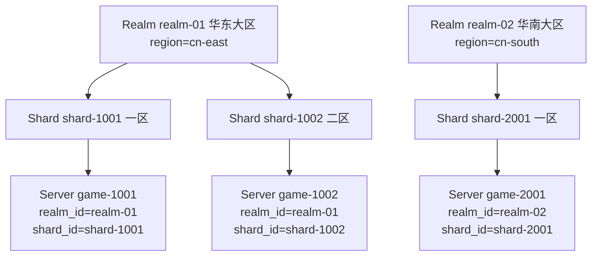

[English](realms-shards.en.md) | [中文](realms-shards.md)

# Realm and Shard

**When to use it**: when a game runs in multiple realms (East China / South China / Overseas) and a
realm is further divided into multiple groups of servers (Zone 1 / Zone 2 / Trial Server), you
need an operations record layer to answer "which realm and which shard does this server belong
to", and to let the client pull the server list by realm or shard. Realm (realm) → Shard (shard)
→ Server (instance) is that three-layer structure.

Games that do not need multi-shard operations management **can skip it entirely** — just do not
write `realm_id` / `shard_id` and everything works as usual (the hierarchy is optional; see
[Concepts Model](/concepts.en) §2).

## At a Glance



- **Realm** belongs to `region` (the geographic/access dimension), **Shard** belongs to Realm,
  and **Server** is attached via the two weak reference fields `realm_id` / `shard_id`.
- **Weak references**: when registering a server you can write `realm_id` / `shard_id` first and
  create the records later (Atlas does no foreign-key validation); the records serve **search
  filtering and operations views** — their absence does not affect registration and heartbeats
  (the platform also provides no delete endpoint for realm / shard — Admin only offers creation
  and listing).

## What It Looks Like Running

Three steps: create the realm → create the shard → attach the server, then the client pulls the
list by dimension.

```bash
# 1. 建大区（管理端 :8082）
curl -X POST http://localhost:8082/v1/admin/realms \
  -H 'Content-Type: application/json' \
  -d '{"id":"realm-01","name":"华东大区","region":"cn-east"}'
# {"id":"realm-01","name":"华东大区","region":"cn-east","status":"active","created_at":"…"}

# 2. 大区下建分服
curl -X POST http://localhost:8082/v1/admin/shards \
  -H 'Content-Type: application/json' \
  -d '{"id":"shard-1001","name":"一区","realm_id":"realm-01"}'
# {"id":"shard-1001","realm_id":"realm-01","name":"一区","status":"active","created_at":"…"}

# 3a. 服务器注册时挂进去（:8081）
curl -X POST http://localhost:8081/v1/registry/servers/register \
  -H 'Content-Type: application/json' \
  -d '{"server_id":"game-1001","region":"cn-east","realm_id":"realm-01","shard_id":"shard-1001",
       "endpoint":{"host":"10.0.1.21","port":30001},"capacity":2000}'

# 3b. 已注册的服务器换分服？重注册即更新（幂等，字段覆盖）
```

The client filters by dimension (:8080):

```bash
curl 'http://localhost:8080/v1/discovery/servers?realm=realm-01'
# 华东大区全部在线服务器

curl 'http://localhost:8080/v1/discovery/servers?shard=shard-1001&status=online'
# 指定分服的在线服务器
```

The operations side queries records (:8082):

```bash
curl 'http://localhost:8082/v1/admin/realms?limit=50'      # 全部大区（新→旧）
curl 'http://localhost:8082/v1/admin/shards?realm_id=realm-01'  # 大区下的分服
```

## Typical Scenarios

### New Realm Server Launch

1. `POST /v1/admin/realms` creates the realm record;
2. `POST /v1/admin/shards` creates the first shard;
3. Write `realm_id` / `shard_id` in the new server's config ([config
   declaration](/server-config.en) or the registration API both work);
4. The client pulls the list by `?realm=` and naturally only sees the new zone.

### Shard Merge (Server Merge)

Shard-level merges are done by [server merge migration](/migration): `POST /v1/admin/migrations`
atomically migrates the source server's character directory to the target; afterwards the source
server goes offline, and the client filtering by the same `shard` dimension is seamless.

### Player Cross-Server Queries with Realm Context

Characters returned by `GET /v1/directory/accounts/{id}/characters` carry `server_id`; combined
with the `realm_id` / `shard_id` of the discovery list, the client can render "character →
realm/shard" in one pass.

## API Cheat Sheet (:8082)

| Method | Path | Description |
| --- | --- | --- |
| `POST` | `/v1/admin/realms` | Create a realm; `{id, name, region, status?}`, `status` defaults to `active`; duplicate ID → `409 REALM_EXISTS` |
| `GET` | `/v1/admin/realms?limit=` | Realm list (sorted by `created_at` descending, default 50) |
| `POST` | `/v1/admin/shards` | Create a shard; `{id, name, realm_id, status?}`; realm does not exist → `404 REALM_NOT_FOUND`, duplicate ID → `409 SHARD_EXISTS` |
| `GET` | `/v1/admin/shards?realm_id=&limit=` | Shard list, filterable by realm |

The server side has only the two weak reference fields: `realm_id` / `shard_id` in the
registration body (can be added later), and the `?realm=` / `?shard=` discovery filters.
