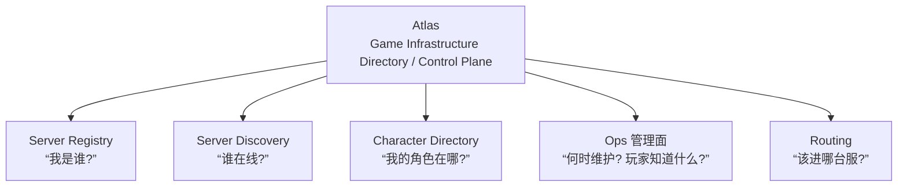

# Roadmap

## Final positioning

> **Atlas is a game infrastructure control plane for online games — Server Registry / Server Discovery / Player Character Directory / Routing & Placement Metadata / Server Lifecycle / Operational Coordination. Not a game backend, not a server list service.**



The positioning statement and the NEVER-owns boundaries (character authoritative data / match state / player sessions /
numeric economy / account authentication) are on the first screen of [architecture.md](architecture.md#_1-overview;) this positioning is
more complete than plain Game Server Discovery, and it is naturally complementary to game server frameworks and account systems.

---

## Current status: v0.1 series fully delivered

**The v0.1 series (internal milestones v0.1.0 ~ v0.1.20) has been fully delivered**, with five public releases:

| Release | Contents |
| --- | --- |
| [v0.1.0](https://github.com/cuihairu/atlas/releases/tag/v0.1.0) | MVP: core model working end to end (Registry / Discovery / Directory / health monitoring / REST API) |
| [v0.1.1](https://github.com/cuihairu/atlas/releases/tag/v0.1.1) | v0.1 series wrap-up: all engineering capabilities filled in on top of the MVP (69 commits) |
| [v0.1.2](https://github.com/cuihairu/atlas/releases/tag/v0.1.2) | Cross-server config center + server tag system + declarative server configuration + dashboard extensions + Docker/deployment leg (50 commits) |
| [v0.1.3](https://github.com/cuihairu/atlas/releases/tag/v0.1.3) | v0.2 prelude: OTel tracing + six-SDK consolidation + memory inverted index/write queue + dash storage queue observability |
| [v0.1.4](https://github.com/cuihairu/atlas/releases/tag/v0.1.4) | Second source walkthrough: event idempotency and RabbitMQ redelivery backoff fixes, live_runtime diagnostics, unsafe-default startup warnings, character read-path bench evidence, bilingual README (20 commits) |

> The early roadmap had event-driven, SDKs, gRPC, and high availability planned across v0.2 ~ v1.0. In actual development they all completed inside the 0.1 series as v0.1.x internal milestones — **every item from the original v0.2 ~ v1.0 has been delivered**; see the table below.

### Delivered capability overview

| Capability | Delivered | Milestone |
| --- | --- | --- |
| ✅ Server Registry | register / heartbeat / unregister, idempotent registration, re-registration recovery | v0.1.0 (recovery semantics fixed by the v0.1.x patrol) |
| ✅ Server Discovery | multi-dimensional filtering + cursor pagination + server details | v0.1.0 |
| ✅ Character Directory | CRUD + account cross-server index, idempotent projection | v0.1.0 |
| ✅ Lifecycle state machine | starting / online / draining / maintenance / suspect / offline / disabled, two-stage failure detection | from v0.1.0, completed in v0.1.x |
| ✅ Admin lifecycle operations | maintenance / drain / enable / disable | v0.1.x |
| ✅ Event sync | EventAdapter abstraction + HTTP / Redis Streams / Kafka / NATS(JetStream) / RabbitMQ | v0.1.2 / v0.1.12 |
| ✅ Prometheus metrics | :8082 `/metrics` (Grafana covered as external guidance in topology.md — no dashboard entity in the repo) | v0.1.3 |
| ✅ Routing server recommendation | `GET /v1/routing/recommended`, per-account character stickiness | v0.1.x |
| ✅ gRPC dual transport | 5 services, 23 RPCs, :9090 (core surface shares the source with REST) | v0.1.5 |
| ✅ Six-language SDKs | Go (dual transport) / C++ / Python (sync and async) / JS/TS / Java / C#, automatic heartbeat built in | v0.1.6 ~ v0.1.11 |
| ✅ APISIX plugins | atlas-auth player token auth injection + atlas-ratelimit endpoint-group rate limiting | v0.1.13 |
| ✅ Realm / Shard management | Admin CRUD + three-store implementations + index migration | v0.1.14 |
| ✅ Health alerting | suspect / offline ratio thresholds + webhook notifications (latching semantics) | v0.1.15 |
| ✅ Character index sharding | account-hash sharding + cross-shard queries + resharding tool | v0.1.16 |
| ✅ Security hardening | Registry mTLS, Admin RBAC + audit (certificate fingerprints), token-bucket rate limiting, three-port security domains | v0.1.17 |
| ✅ Dashboard enhancements | real-time server map, player trends, migration progress, theme switching, Chinese/English i18n, server load heatmap (REST + gRPC + dash pages, delivered 2026-10-12) | v0.1.18 |
| ✅ High availability | Redis sentinel/cluster, PG connection pool tuning, HAProxy heartbeat fan-in, primary-replica replication guide | v0.1.19 |
| ✅ Admin plane: maintenance windows and announcements | server metadata, planned maintenance windows (scheduled automatic entry/exit), announcement system (three severity levels) | v0.1.20 |
| ✅ Quality infrastructure | service/handler coverage >80% target (CI report + Codecov upload, not a failing gate), performance benchmarks, Dependabot, periodic security audit CI | v0.1.x |

How to use each capability and in which scenarios — see the [README usage scenarios](https://github.com/cuihairu/atlas#使用场景) and [Announcements and Planned Maintenance](operations.md).

### Explicitly not doing (scope discipline)

```text
❌ Kubernetes Operator      —— Atlas 是普通无状态服务，compose/k8s 自行编排即可
❌ Service Mesh 集成        —— 不绑定任何 mesh，保持标准 REST/gRPC
❌ 复杂调度算法             —— Routing 只做推荐/定位元数据，不做调度器
❌ 强绑定 APISIX            —— 网关永远是可选集成层
❌ 角色权威数据              —— Directory 永远是 Projection
❌ 匹配 / 排队 / 房间        —— 撮合决策是 Scheduler 的职责，Atlas 不进匹配池
❌ 实例 / Zone 分配          —— 实例创建与放置归实例管理器，Atlas 只发布候选集
❌ 玩家 Session / 登录态     —— 会话恢复归游戏侧管理服务
❌ 背包 / 经济 / 排行榜等业务表 —— 游戏业务数据库的事，Atlas 连列都不建
```

These are not "not yet done" — they are **design decisions**: Atlas is a control-plane directory service, and every item above has a more appropriate home.
They can integrate with Atlas (a scheduler reads Discovery candidate sets, player services write Directory events), but they are **not built in** — the litmus test is the positioning statement in [architecture.md](architecture.md#_1-overview.)

---

## v0.2+ candidate directions

The following is a **candidate list, not a commitment** — scheduling is demand-driven, and issue discussion is welcome:

| Direction | Description | Preconditions |
| --- | --- | --- |
| **API stabilization and v1.0** | Freeze the REST/gRPC contracts, commit to compatibility, official v1.0 release | API surface sufficiently validated in production |
| ✅ **Discovery read-path pipelining** (P1, delivered 2026-10-04) | `RuntimeStore.GetRuntimes` batch reads: Redis pipeline with a single Exec (N RTTs → 1–2, Cluster batches by slot), memory reads everything under one lock; the list path merges into batches while single-server details are unchanged; contract tests and degradation semantics pinned down (commits 9f99745 / 8201f57). Decision-surface wrap-up (2026-10-05): the health patrol sweep and Routing recommendation/diagnostics merge into the same batching, failures propagate fail-closed | Done; benchmarks and round-trip estimates in [Performance Design](/performance) §2 / [Benchmarks](/benchmarks) §3 |
| ✅ **Failure-mode regression suite** (P1, delivered 2026-10-04) | Item-by-item automation of the "correctness before QPS" drill matrix ([Performance Design](/performance) §7): partition patrol / re-registration contract / idempotency and rollback / Redis FLUSHALL data loss (miniredis as the fallback, contracts no longer skip); only PG connection-pool self-healing and replica downtime remain deployment-level drills (ha.md) | Done; verification locations in the §7 table |
| 🔒 **Explicit three-state status (locked in)** | Concepts finalized (lifecycle §0 / architecture §4.4 / data-model storage annotations) + code annotations in place (the `ServerStatus` type and `Server.Status` field are annotated with the three-state layering); **field / interface renames not done** — to be executed only in the v1.0 API freeze window, to avoid contract fragmentation | v1.0 API freeze window (execute when triggered) |
| 🚧 **Migration Controller standalone module (partially delivered, 2026-10-14)** | Concept boundaries finalized (migration §9) and code split already in place (`internal/admin` orchestration / `internal/directory` projection, zero cross-talk); **code module split delivered**: the orchestration state machine extracted into the standalone package `internal/migration` (narrow Store interface, zero storage dependencies), `internal/admin` keeps only a thin delegation, REST/gRPC contracts unchanged; **splitting into a standalone service not done** — only when independent scaling has a real need | Multi-fleet dedicated migration clusters / independent scaling (execute when triggered) |
| ✅ **Routing maintenance lead-in** (P1, delivered 2026-10-04) | Recommendation aware of maintenance windows: servers whose window is active or starts within the Lead (default 5m, tunable via `ATLAS_ROUTING_MAINTENANCE_LEAD`) are excluded — strict/fallback both stages apply consistently, fully excluded returns an honest 404; diagnose lays out the window verdict per server (`maintenance_window` field + `maintenance_window=active|upcoming` reason), `eligible` counts the window | Done; semantics in [API §Routing](/api#routing) and [Lifecycle §5](/lifecycle#_5-scheduled-maintenance-windows-v0-1-20) |
| ✅ **Routing policy extension: weights (delivered 2026-10-14)** | Ops weight `weight` (1..1000, 0 = neutral) on the server record (migration 0007, admin-owned: register/heartbeat never rewrite it, set via `POST /v1/admin/servers/{id}/weight`); recommendation sorting step 2 now compares **effective load** `load × 100 / weight` — a weight >100 attracts roughly the proportional share of traffic in steady state (e.g. 200 ≈ double), <100 suppresses, i.e. a canary rollout knob (pair with a private tag to scope the canary group = whitelist); only recommendation metadata changes, no crossing the scheduling boundary: status/maintenance windows/existing-character priority all behave as before; the diagnostics page shows `weight` + `effective_load` per server (contract across the three stores + routing/admin/httpapi tests green) | Done |
| ✅ **Announcement and window batch orchestration** (fully delivered 2026-10-14) | Fleet-level window templates (`stagger_seconds` rolling stagger / `dry_run` preview / partial-success semantics) + batch creation delivered: `POST /v1/admin/maintenance-windows/batch`, with a "Batch Windows" entry on the dashboard ops page listing per-server success/failure; **migration-window linkage delivered**: `CreateMigration` automatically lays a 24h maintenance window on source servers (reusing the batch window API, fail-closed: if windows cannot be laid down the migration record is not written; windows are not auto-cancelled, ops can DELETE manually) — `migration.Service` holds an optional `WindowCreator` interface (timing belongs to the migration package, window creation injected by admin, no reverse dependency), migration/admin/httpapi tests green; see [migration.md §9.1](/migration#_9-1-migration-window-linkage) | Done |
| ✅ **Observability deepening (phase 1 + registry write path + Admin counters + span tree)** | Phase 1: request-level tracing with X-Request-ID threaded through all three listeners + directory write-path latency metric `atlas_directory_write_duration_seconds`; phase 2 (2026-10-04): registry write-path metrics `atlas_registry_write_duration_seconds{op}` (`op` = register / heartbeat / unregister) — the fleet's hottest write path, where write degradation shows up first; phase 3 (2026-10-07): `atlas_admin_requests_total` extended to gRPC Admin RPCs (endpoint = full method name, status = mapped HTTP code, same outermost chain position as REST, rejected calls counted too); phase 4 (2026-10-07): X-Request-ID threaded through the gRPC port (`x-request-id` metadata reuse/generate/echo + `grpc request` access logs, tracing interceptor outermost, rejected RPCs also get an id); phase 5 (2026-10-08): OpenTelemetry span tree decided and landed — official OTel Go SDK + OTLP/HTTP export (the protocol is the commitment, the backend is not locked in; Jaeger / Tempo / vendor collectors can all receive), unset `ATLAS_OTLP_ENDPOINT` means a global no-op with zero overhead (the same default philosophy as gRPC TLS defaulting to plaintext when unset), server root spans opened per REST route pattern / per full gRPC method name, the four services registry / discovery / routing / directory automatically attach `internal` child spans forming a tree, `atlas.request_id` shares the id with X-Request-ID for cross-lookup in logs, ParentBased sampling via `ATLAS_TRACING_SAMPLE_RATIO` | Done; metrics still go through Prometheus, no second metrics backend introduced (0fe965d / f5359e2) |
| ✅ **Kubernetes deployment example** (delivered 2026-10-14) | Basic manifests delivered: `deploy/k8s/` (namespace + configmap + postgres StatefulSet + redis Deployment + migration Job + atlas Deployment/Service + README deployment guide and production checklist); **boundaries unchanged**: no Helm chart, no Operator (the [Explicitly Not Doing](#explicitly-not-doing-scope-discipline) list) — Atlas is a stateless service, Deployment+Service suffices on K8s | Done |

---

## Evolution principles

### 1. Get the model working first, engineering second

The 0.1 series proved this order right: the core model (registration, discovery, projection) stabilized first, and the event bus, SDKs, gRPC, and high availability were layered onto that foundation milestone by milestone.

### 2. Atlas Core is independent of any gateway

APISIX has been an **optional integration layer**, not a dependency, since day one. This principle runs through every version.

### 3. The Character Directory is always a Projection

No version should let Atlas hold authoritative character data. This is a responsibility boundary, not a performance trade-off.

### 4. Write APIs idempotent from day one

Whether HTTP or Message Bus, retries must not cause side effects. This decision costs almost nothing up front but is extremely expensive to regret.

### 5. Hierarchy stays optional

The optionality of Region / Realm / Shard will not tighten as features grow. The topology differences between MMORPGs, MOBAs, and SLGs are permanent.

### 6. Fix the boundaries first, then add features (Control Plane discipline)

Before any new feature is approved, answer "is this a directory problem or a runtime problem":

- Directory problems (who is online / where are the characters / which server to join / when to maintain) — candidates, scheduled by demand;
- Runtime problems (admit or not / how to match / where to place instances / what is in the inventory) — **not built in**; just provide the integration point with Atlas.

This discipline is the live litmus test behind the "Explicitly Not Doing" list, keeping Atlas from bloating into a game platform backend.
The positioning statement is in [architecture.md](architecture.md#_1-overview;) module boundaries in [migration.md](migration.md) §9.

---

## Project structure

```text
atlas/
├── cmd/                    服务入口与工具（atlas 主服务 / crossagent / demoagents / reshard）
├── internal/
│   ├── model/              领域模型（Server, Character, Realm, Shard…）
│   ├── store/              存储接口
│   │   ├── memory/         内存实现（测试 + 开发）
│   │   ├── postgres/       PostgreSQL 实现
│   │   ├── mysql/          MySQL 实现
│   │   ├── redisstore/     Redis 运行时状态
│   │   └── sharded/        一致性哈希分片包装
│   ├── registry/           注册 / 心跳 / 注销
│   ├── discovery/          服务器发现
│   ├── directory/          角色目录
│   ├── routing/            接入推荐
│   ├── admin/              Admin 服务（Realm/Shard/维护窗口/公告/迁移/审计）
│   ├── health/             健康监控（自动掉线 + 占比告警）
│   ├── event/              事件适配器（redis/kafka/nats/rabbitmq）
│   ├── httpapi/            REST API handlers
│   ├── grpc/               gRPC 服务
│   ├── metrics/            Prometheus 指标
│   ├── tlsutil/            mTLS 辅助
│   ├── tracing/            请求追踪（X-Request-ID 贯通三监听口）
│   ├── crossserver/        跨服配置中心（发布 / 订阅 / 回调 / 轮询）
│   ├── fleet/              舰队实时索引（load-series / 匹配判定）
│   ├── serversconfig/      服务器配置文件托管（config-owned 记录）
│   ├── telemetry/          负载与总线序列采样（load-series / bus-series）
│   ├── config/             环境变量配置
│   └── version/            版本信息
├── api/proto/              gRPC proto 定义
├── migrations/             SQL migration
├── sdk/                    六语言 SDK（go/cpp/python/js/java/csharp）
├── plugins/apisix/         APISIX 接入插件
├── dashboard/              内置管理台（前端源码与构建产物）
├── examples/               各语言可运行示例
├── deploy/                 haproxy / postgres / redis 部署配置
├── deployments/docker/     Dockerfile + docker-compose
├── docs/                   设计文档（VitePress 站点）
├── Makefile
├── .env.example
└── go.mod
```

**Current status**: the v0.1 series is fully delivered, with five public releases (v0.1.0 ~ v0.1.4, v0.1.4 the latest). Future directions are under "v0.2+ candidate directions".
