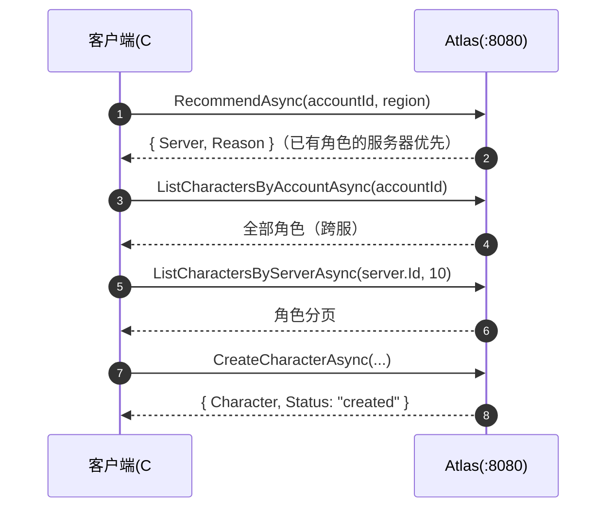

[English](sdk-csharp.en.md) | [中文](sdk-csharp.md)

# C# SDK

`sdk/csharp/` (delivered in v0.1.11). An HttpClient + System.Text.Json REST
client with the same API surface as the Go / C++ / Python / JS / Java SDKs.
Targets net8.0 + net10.0, zero third-party dependencies, NuGet package name
`Atlas.Client`.

## Installation

```bash
dotnet add package Atlas.Client
```

## Quick start

```csharp
using Atlas;

var options = new AtlasClientOptions
{
    BaseUrl = "http://localhost:8080",
    RegistryBaseUrl = "http://localhost:8081", // Registry 独立端口（可选）
    RegistryToken = "...",                     // Registry 域 Bearer
    AdminApiKey = "...",                       // Admin 域 API Key
    DefaultHeaders = new() { ["X-Request-ID"] = "..." }, // 每次调用都带的静态头（可选，关联 id 见 api.md「请求追踪」）
};
using var client = new AtlasClient(options);

var reg = await client.RegisterAsync(new RegisterRequest(   // 注册
    "game-1001", "Game 1001", "cn-east",
    new Endpoint { Host = "10.0.0.1", Port = 30001 }, 2000));

await client.HeartbeatAsync("game-1001", new HeartbeatRequest()); // 首跳同步：在线后才可被发现
var loop = client.StartHeartbeat("game-1001", TimeSpan.FromSeconds(10), // 自动心跳
    onError: e => Console.Error.WriteLine(e));
loop.Set(players: 120, load: 0.35);                         // 游戏线程更新负载

var rec = await client.RecommendAsync(42, "cn-east");       // 接入推荐
var page = await client.ListCharactersByServerAsync(rec.Server.Id, 10); // 角色目录
await client.CreateCharacterAsync(
    new CreateCharacterRequest(42, rec.Server.Id, 1001, "Hero"));

loop.Stop();                                                // 优雅下线
await client.UnregisterAsync("game-1001");
```

## Client options

`AtlasClientOptions` (all optional):

| Option | Default | Description |
| --- | --- | --- |
| `BaseUrl` | `http://localhost:8080` | Base address for the public network + Admin domain |
| `RegistryBaseUrl` | same as `BaseUrl` | Override for the standalone Registry port (`:8081`); no need to set it when merged behind a reverse proxy |
| `RegistryToken` | empty | Registry domain Bearer (one of `ATLAS_REGISTRY_TOKENS`) |
| `AdminApiKey` | empty | Admin domain API Key (one of `ATLAS_ADMIN_API_KEYS`) |
| `DefaultHeaders` | empty | Static headers sent with every call (keys override as-is; process-level `X-Request-ID` correlation id goes here, see api.md "Request tracing") |
| `TimeoutMs` | `10000` | `HttpClient.Timeout`; `0` disables it; a timeout participates in retries as a network error |
| `MaxRetries` | `3` | Number of retries for transient failures (network errors / 5xx); 4xx is not retried |
| `BaseBackoffMs` | `100` | Backoff ceiling for the first retry, doubling each time + full jitter, capped at 10s |
| `HttpInvoker` | empty | Inject a self-managed `HttpClient` (Polly / IHttpClientFactory scenarios); once injected, the SDK is not responsible for disposing it |

## Full API overview

All methods take a trailing `CancellationToken ct = default` parameter.

### Registry (Service Token, goes through `RegistryBaseUrl`)

| Method | Returns | Description |
| --- | --- | --- |
| `RegisterAsync(RegisterRequest)` | `Task<RegisterResult>` | Idempotent registration |
| `HeartbeatAsync(serverId, HeartbeatRequest)` | `Task<HeartbeatResult>` | `Status` is the server's **currently effective status** (returned truthfully when suspect/offline — don't just look at HTTP 200) |
| `UnregisterAsync(serverId)` | `Task<StatusResult>` | Take the server offline proactively |

### Discovery (public network)

| Method | Returns | Description |
| --- | --- | --- |
| `ListServersAsync(ServerFilter? filter = null)` | `Task<List<Server>>` | null = full list |
| `GetServerAsync(serverId)` | `Task<Server>` | Details for a single server |

### Directory (public read, game server write)

| Method | Returns | Description |
| --- | --- | --- |
| `CreateCharacterAsync(CreateCharacterRequest)` | `Task<CharacterWriteResult>` | |
| `GetCharacterAsync(long characterId)` | `Task<Character>` | |
| `ListCharactersByAccountAsync(long accountId)` | `Task<List<Character>>` | All characters of an account across servers |
| `ListCharactersByServerAsync(serverId, limit, cursor)` | `Task<CharacterPage>` | Pass the previous page's `NextCursor` to page |
| `UpdateCharacterAsync(characterId, UpdateCharacterRequest)` | `Task<CharacterWriteResult>` | Fields not set remain unchanged (PATCH) |
| `DeleteCharacterAsync(characterId)` | `Task<CharacterWriteResult>` | |

### Routing (public network)

| Method | Returns | Description |
| --- | --- | --- |
| `RecommendAsync(accountId, region?, version?, platform?)` | `Task<Recommendation>` | `{Server, Reason}`; `Reason` ∈ `lowest_load` / `highest_capacity` / `has_character` / `fallback`; character stickiness is only triggered when `accountId > 0` |

### Admin (API Key, goes through `BaseUrl`)

| Method | Returns | Description |
| --- | --- | --- |
| `SetMaintenanceAsync` / `SetDrainAsync` / `EnableAsync` / `DisableAsync(serverId)` | `Task<StatusResult>` | Lifecycle operations |
| `SetWeightAsync(serverId, weight)` | `Task<WeightResult>` | Canary routing weight: `0` neutral, `1..1000`; out of range returns 400; the `Server` model also carries `weight` (default 0), `started_at` (process start time), `source` (config = managed by config file) |
| `StatsAsync()` | `Task<Stats>` | Fleet statistics |
| `SearchCharactersAsync(CharacterFilter)` | `Task<CharacterPage>` | `Name / ServerId / ClassId / MinLevel / MaxLevel / Limit / Cursor` |
| `CreateMigrationAsync(CreateMigrationRequest)` | `Task<Migration>` | `SourceServers` array + `TargetServer`; a server merge can have multiple sources |
| `GetMigrationAsync(id)` / `ListMigrationsAsync(limit = 0)` | `Task<Migration>` / `Task<List<Migration>>` | |
| `RollbackMigrationAsync(id)` | `Task<Migration>` | One-click rollback |

### Automatic heartbeat

| Member | Description |
| --- | --- |
| `StartHeartbeat(serverId, TimeSpan interval, HeartbeatRequest? req = null, Action<AtlasError>? onError = null)` | Sends one beat immediately, then keeps reporting every `interval`; when you need to be recommendable right away, call `HeartbeatAsync` synchronously once first |
| `loop.Set(int players, double load)` | Thread-safe update of the next beat's payload |
| `loop.OnError(Action<AtlasError>)` | Callback on every failure; the loop does not stop |
| `loop.Stop()` | Idempotent stop |
| `loop.Dispose()` / `DisposeAsync()` | Equivalent to `Stop()` |
| `client.Dispose()` / `DisposeAsync()` | Releases the internal `HttpClient` (except for a self-injected `HttpInvoker`) |

## Scenario: player login and server selection



## Scenario: graceful shutdown of a game server

```csharp
await client.SetDrainAsync("game-1001");   // 1. 停止接新玩家
// ... 等存量玩家离开 ...
loop.Stop();                               // 2. 停心跳
await client.UnregisterAsync("game-1001"); // 3. 注销
```

For the complete example see [`examples/csharp`](https://github.com/cuihairu/atlas/blob/main/examples/csharp/Program.cs):

```bash
dotnet run --project examples/csharp
```

## Error handling

All methods throw `AtlasError` on failure:

| Field | Description |
| --- | --- |
| `Status` | HTTP status code; `0` = network error (thrown after retries are exhausted) |
| `Code` | Matches the REST error codes (`INVALID_ARGUMENT` / `SERVER_NOT_FOUND` / `RATE_LIMITED` / `STORAGE_UNAVAILABLE` / `NETWORK` …) |
| `Message` | Server error message or network error description |

The automatic heartbeat loop **does not throw** — failures go to the `OnError` callback and the loop continues.

## Key semantics

| Topic | Description |
| --- | --- |
| Retries | Network errors + 5xx are retried automatically with full-jitter exponential backoff (`MaxRetries` defaults to 3, capped at 10s); 4xx is not retried |
| Heartbeat cadence | Reporting interval : failure-detection threshold = 1:3 (defaults 10s / suspect 30s / offline 60s); the example sends the first beat synchronously before starting the loop, avoiding the "recommended before registration is online" race |
| Directory write reply | Synchronous REST returns a flat Character object (the SDK parses it by JSON shape and normalizes it to `status="created"/"updated"`); the async adapter returns `{"status":"queued"}` (`Character` is null) |
| Three ports | `BaseUrl` covers the public network/Admin; `RegistryBaseUrl` covers the standalone Registry port; when merged behind a reverse proxy, both can have the same value |
| Empty collections | An empty list from the server may be serialized as `null`; the SDK treats it as `[]` (servers / characters / migrations all have this fallback) |
| Naming | snake_case at the transport layer, PascalCase at the SDK layer (bidirectional mapping via `JsonNamingPolicy.SnakeCaseLower`), timestamps are `DateTimeOffset` |
| External injection | `HttpInvoker` can take a self-managed `HttpClient` (Polly/IHttpClientFactory scenarios); in that case the SDK is not responsible for disposing it |
