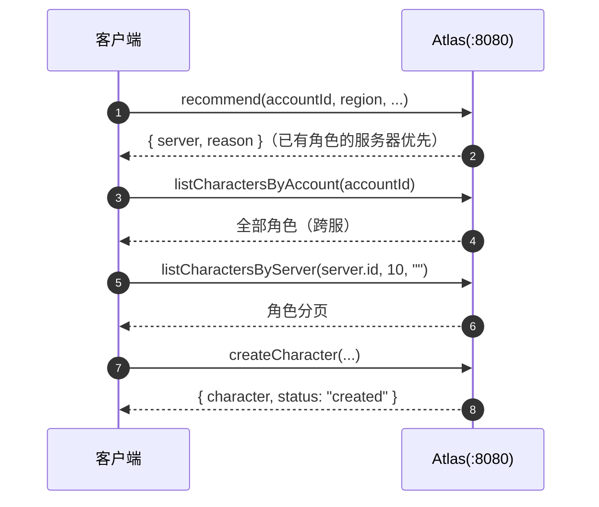

# Java SDK

`sdk/java/` (delivered in v0.1.10). An OkHttp + Gson REST client with the same
API surface as the Go / C++ / Python / JS SDKs. Java 17+, synchronous blocking
interface, published coordinates `io.github.cuihairu:atlas-client`, with both
Maven + Gradle build configurations.

## Installation

```xml
<dependency>
  <groupId>io.github.cuihairu</groupId>
  <artifactId>atlas-client</artifactId>
  <version>0.1.10</version>
</dependency>
```

```groovy
implementation 'io.github.cuihairu:atlas-client:0.1.10'
```

## Quick start

```java
try (AtlasClient client = new AtlasClient(new AtlasClientOptions()
        .setBaseUrl("http://localhost:8080")
        .setRegistryBaseUrl("http://localhost:8081")  // Registry 独立端口（可选）
        .setRegistryToken("...")                      // Registry 域 Bearer
        .setAdminApiKey("...")                        // Admin 域 API Key
        .setDefaultHeaders(Map.of("X-Request-ID", "..."))) { // 每次调用都带的静态头（可选，关联 id 见 api.md「请求追踪」）

    var reg = client.register(new RegisterRequest(      // 注册
            "game-1001", "Game 1001", "cn-east",
            new Endpoint("10.0.0.1", 30001), 2000));

    client.heartbeat("game-1001", new HeartbeatRequest()); // 首跳同步：在线后才可被发现
    AutoHeartbeat loop = client.startHeartbeat("game-1001", 10_000, // 自动心跳
            new HeartbeatRequest(), err -> log.warning(err.getMessage()));
    loop.set(120, 0.35);                                // 游戏线程更新负载

    Recommendation rec = client.recommend(42, "cn-east", null, null);   // 接入推荐
    CharacterPage page = client.listCharactersByServer(rec.server.id, 10, ""); // 角色目录
    var wr = client.createCharacter(new CreateCharacterRequest(
            42, rec.server.id, 1001, "Hero"));

    loop.stop();                                        // 优雅下线
    client.unregister("game-1001");
}
```

## Client options

`AtlasClientOptions` (chained setters, all optional):

| Option | Default | Description |
| --- | --- | --- |
| `setBaseUrl` | `http://localhost:8080` | Base address for the public network + Admin domain |
| `setRegistryBaseUrl` | same as `baseUrl` | Override for the standalone Registry port (`:8081`); no need to set it when merged behind a reverse proxy |
| `setRegistryToken` | empty | Registry domain Bearer (one of `ATLAS_REGISTRY_TOKENS`) |
| `setAdminApiKey` | empty | Admin domain API Key (one of `ATLAS_ADMIN_API_KEYS`) |
| `setDefaultHeaders` | empty | Static headers sent with every call (keys override as-is; process-level `X-Request-ID` correlation id goes here, see api.md "Request tracing") |
| `setTimeoutMs` | `10000` | OkHttp `callTimeout`; `0` disables the timeout |
| `setMaxRetries` | `3` | Number of retries for transient failures (network errors / 5xx); 4xx is not retried |
| `setBaseBackoffMs` | `100` | Backoff ceiling for the first retry, doubling each time + full jitter, capped at 10s |

## Full API overview

### Registry (Service Token, goes through `registryBaseUrl`)

| Method | Returns | Description |
| --- | --- | --- |
| `register(RegisterRequest)` | `RegisterResult` | Idempotent registration |
| `heartbeat(serverId, HeartbeatRequest)` | `HeartbeatResult` | `status` is the server's **currently effective status** (returned truthfully when suspect/offline — don't just look at HTTP 200) |
| `unregister(serverId)` | `StatusResult` | Take the server offline proactively |

### Discovery (public network)

| Method | Returns | Description |
| --- | --- | --- |
| `listServers()` / `listServers(ServerFilter)` | `List<Server>` | No arguments = full list |
| `getServer(serverId)` | `Server` | Details for a single server |

### Directory (public read, game server write)

| Method | Returns | Description |
| --- | --- | --- |
| `createCharacter(CreateCharacterRequest)` | `CharacterWriteResult` | |
| `getCharacter(long characterId)` | `Character` | |
| `listCharactersByAccount(long accountId)` | `List<Character>` | All characters of an account across servers |
| `listCharactersByServer(serverId)` / `(serverId, limit, cursor)` | `CharacterPage` | Pass the previous page's `nextCursor` to page |
| `updateCharacter(characterId, UpdateCharacterRequest)` | `CharacterWriteResult` | Fields not set remain unchanged (PATCH) |
| `deleteCharacter(characterId)` | `CharacterWriteResult` | |

### Routing (public network)

| Method | Returns | Description |
| --- | --- | --- |
| `recommend()` / `recommend(accountId, region, version, platform)` | `Recommendation` | `{server, reason}`; `reason` ∈ `lowest_load` / `highest_capacity` / `has_character` / `fallback`; character stickiness is only triggered when `accountId > 0` |

### Admin (API Key, goes through `baseUrl`)

| Method | Returns | Description |
| --- | --- | --- |
| `setMaintenance` / `setDrain` / `enable` / `disable(serverId)` | `StatusResult` | Lifecycle operations |
| `setWeight(serverId, weight)` | `WeightResult` | Canary routing weight: `0` neutral, `1..1000`; out of range returns 400; the `Server` model also carries `weight` (default 0), `started_at` (process start time), `source` (config = managed by config file) |
| `getStats()` | `Stats` | Fleet statistics |
| `searchCharacters(CharacterFilter)` | `CharacterPage` | `name / serverId / classId / minLevel / maxLevel / limit / cursor` |
| `createMigration(CreateMigrationRequest)` | `Migration` | `source_servers` array + `target_server`; a server merge can have multiple sources |
| `getMigration(id)` / `listMigrations()` / `(limit)` | `Migration` / `List<Migration>` | |
| `rollbackMigration(id)` | `Migration` | One-click rollback |

### Automatic heartbeat

| Member | Description |
| --- | --- |
| `startHeartbeat(serverId)` | Default 10s interval |
| `startHeartbeat(serverId, intervalMs, initial)` | Specify the interval and the initial payload |
| `startHeartbeat(serverId, intervalMs, initial, onError)` | Failure callback; the loop does not stop |
| `loop.set(int players, double load)` | Atomically updates the next beat's payload (`AtomicReference`); callable from the game thread at any time |
| `loop.stop()` | Idempotent stop |
| `client.close()` | Releases the OkHttp connection pool and dispatcher (try-with-resources); it does **not** stop the heartbeat loop, call `loop.stop()` first |

The heartbeat runs on a **daemon thread** `atlas-heartbeat-<serverId>` (`scheduleAtFixedRate`, sends the first beat immediately) — it does not block JVM exit, but it also means you should remember `stop()` + `unregister()` before the main thread exits.

## Scenario: player login and server selection



## Scenario: graceful shutdown of a game server

```java
client.setDrain("game-1001");   // 1. 停止接新玩家
// ... 等存量玩家离开 ...
loop.stop();                    // 2. 停心跳
client.unregister("game-1001"); // 3. 注销
```

For the complete example see [`examples/java`](https://github.com/cuihairu/atlas/blob/main/examples/java/src/main/java/io/github/cuihairu/example/AtlasExample.java):

```bash
mvn install -f sdk/java/pom.xml          # SDK 进本地仓库
cd examples/java
ATLAS_ADDR=http://localhost:8080 ATLAS_REGISTRY_ADDR=http://localhost:8081 mvn exec:java
```

## Error handling

All methods throw `AtlasError` (unchecked) on failure:

| Field | Description |
| --- | --- |
| `getStatus()` | HTTP status code; `0` = network error (thrown after retries are exhausted) |
| `getCode()` | Matches the REST error codes (`INVALID_ARGUMENT` / `SERVER_NOT_FOUND` / `RATE_LIMITED` / `STORAGE_UNAVAILABLE` / `NETWORK` …) |
| `getMessage()` | Server error message or network error description |

The automatic heartbeat loop **does not throw** — failures go to the `onError` callback and the loop continues.

## Key semantics

| Topic | Description |
| --- | --- |
| Retries | Network errors + 5xx are retried automatically with full-jitter exponential backoff (`maxRetries` defaults to 3); 4xx is not retried |
| Heartbeat cadence | Reporting interval : failure-detection threshold = 1:3 (defaults 10s / suspect 30s / offline 60s); the example sends the first beat synchronously before starting the loop, avoiding the "recommended before registration is online" race |
| Directory write reply | Synchronous REST returns a flat Character object (the SDK normalizes it to `status="created"/"updated"`); the async adapter returns `{"status":"queued"}` (`character` is null) |
| Three ports | `baseUrl` covers the public network/Admin; `registryBaseUrl` covers the standalone Registry port; when merged behind a reverse proxy, both can have the same value |
| Empty collections | An empty list from the server may be serialized as `null`; the SDK treats it as `[]`; explicit null fields get the same fallback |
| Naming | snake_case at the transport layer, camelCase at the SDK layer (bidirectional mapping via Gson `@SerializedName`), timestamps are `java.time.Instant` |
