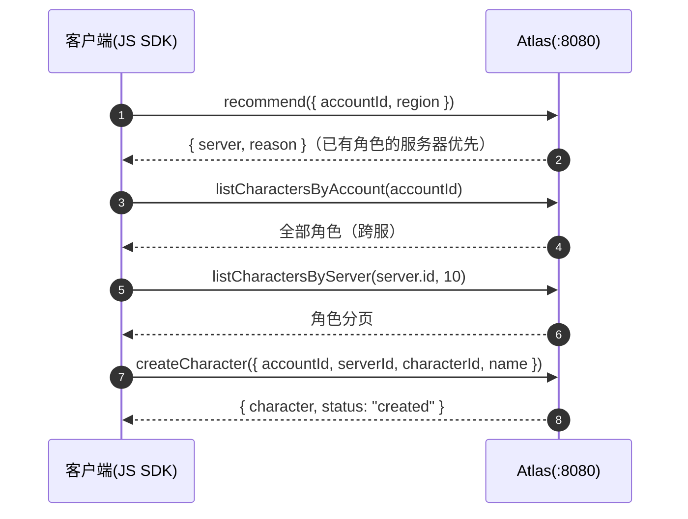

[English](sdk-js.en.md) | [中文](sdk-js.md)

# JavaScript/TypeScript SDK

`sdk/js/` (delivered in v0.1.9). A `fetch`-based REST client with the same API
surface as the Go / C++ / Python SDKs. Zero runtime dependencies, works on
Node.js 18+ and modern browsers; the npm artifact ships both ESM + CJS formats
with complete TypeScript types.

## Installation

```bash
npm install @cuihairu/atlas-client
```

## Quick start

```ts
import { AtlasClient } from "@cuihairu/atlas-client";

const client = new AtlasClient({
  baseUrl: "http://localhost:8080",
  registryBaseUrl: "http://localhost:8081", // Registry 独立端口（可选）
  registryToken: "...",                     // Registry 域 Bearer
  adminApiKey: "...",                       // Admin 域 API Key
  defaultHeaders: { "X-Request-ID": "..." }, // 每次调用都带的静态头（可选，关联 id 见 api.md「请求追踪」）
});

await client.register({                     // 注册
  serverId: "game-1001", name: "Game 1001",
  region: "cn-east", capacity: 2000,
  endpoint: { host: "10.0.0.1", port: 30001 },
});
await client.heartbeat("game-1001", {});    // 首跳同步：在线后才可被发现
const loop = client.startHeartbeat("game-1001", { intervalMs: 10_000 }); // 自动心跳
loop.set(120, 0.35);                        // 游戏线程更新负载

const rec = await client.recommend({ accountId: 42, region: "cn-east" }); // 接入推荐
const page = await client.listCharactersByServer(rec.server.id, 10);      // 角色目录
const wr = await client.createCharacter({
  accountId: 42, serverId: rec.server.id,
  characterId: 1001, name: "Hero", level: 1,
});

await loop.stop();                          // 优雅下线（排空在途心跳）
await client.unregister("game-1001");
client.close();
```

## Client options

`AtlasClientOptions` (all optional):

| Option | Default | Description |
| --- | --- | --- |
| `baseUrl` | `http://localhost:8080` | Base address for the public network + Admin domain (a trailing `/` is stripped automatically) |
| `registryBaseUrl` | same as `baseUrl` | Override for the standalone Registry port (`:8081`); no need to set it when merged behind a reverse proxy |
| `registryToken` | empty | Registry domain Bearer (one of `ATLAS_REGISTRY_TOKENS`) |
| `adminApiKey` | empty | Admin domain API Key (one of `ATLAS_ADMIN_API_KEYS`) |
| `defaultHeaders` | empty | Static headers sent with every call (keys override as-is; process-level `X-Request-ID` correlation id goes here, see api.md "Request tracing") |
| `timeoutMs` | `10000` | `AbortSignal.timeout` for each attempt; `0` disables the timeout |
| `maxRetries` | `3` | Number of retries for transient failures (network errors / timeouts / 5xx); 4xx is not retried |
| `baseBackoffMs` | `100` | Backoff ceiling for the first retry, doubling each time + full jitter, capped at 10s |

## Full API overview

### Registry (Service Token, goes through `registryBaseUrl`)

| Method | Returns | Description |
| --- | --- | --- |
| `register(req)` | `{ serverId, status }` | Idempotent registration; `type` defaults to `"game"`; `realmId` / `shardId` / `metadata` are optional |
| `heartbeat(serverId, { players?, load? })` | `{ serverId, status, nextHeartbeatIn }` | `status` is the server's **currently effective status** (returned truthfully when suspect/offline — don't just look at HTTP 200) |
| `unregister(serverId)` | `{ serverId?, status }` | Take the server offline proactively |

### Discovery (public network)

| Method | Returns | Description |
| --- | --- | --- |
| `listServers(filter?)` | `Server[]` | filter: `{ region?, version?, platform?, status?, limit? }` |
| `getServer(serverId)` | `Server` | Details for a single server |

### Directory (public read, game server write)

| Method | Returns | Description |
| --- | --- | --- |
| `createCharacter(req)` | `CharacterWriteResult` | Required: `accountId / serverId / characterId / name`; `level / classId / avatar` optional |
| `getCharacter(characterId)` | `Character` | |
| `listCharactersByAccount(accountId)` | `Character[]` | All characters of an account across servers |
| `listCharactersByServer(serverId, limit?, cursor?)` | `CharacterPage` | Only takes effect when `limit > 0`; pass the previous page's `nextCursor` to page |
| `updateCharacter(characterId, req)` | `CharacterWriteResult` | Fields not set remain unchanged (PATCH) |
| `deleteCharacter(characterId)` | `CharacterWriteResult` | |

### Routing (public network)

| Method | Returns | Description |
| --- | --- | --- |
| `recommend({ accountId?, region?, version?, platform? })` | `{ server, reason }` | `reason` ∈ `lowest_load` / `highest_capacity` / `has_character` / `fallback`; character stickiness is only triggered when `accountId > 0` |

### Admin (API Key, goes through `baseUrl`)

| Method | Returns | Description |
| --- | --- | --- |
| `setMaintenance(serverId)` / `setDrain` / `enable` / `disable` | `StatusResult` | Lifecycle operations |
| `setWeight(serverId, weight)` | `WeightResult` | Canary routing weight: `0` neutral, `1..1000`; out of range returns 400; the `Server` interface also carries `weight` (default 0), `startedAt` (process start time), `source` (config = managed by config file) |
| `getStats()` | `Stats` | Fleet statistics (server count by status/region/version, total online, total capacity, total characters) |
| `searchCharacters(filter)` | `CharacterPage` | filter: `{ name?, serverId?, classId?, minLevel?, maxLevel?, limit?, cursor? }` |
| `createMigration({ sourceServers, targetServer })` | `Migration` | Server merge can have multiple sources |
| `getMigration(id)` / `listMigrations(limit?)` | `Migration` / `Migration[]` | |
| `rollbackMigration(id)` | `Migration` | One-click rollback |

### Automatic heartbeat

| Member | Description |
| --- | --- |
| `startHeartbeat(serverId, opts?)` | Sends one beat immediately, then keeps reporting every `intervalMs` (default 10000) |
| `loop.set(players, load)` | The game thread updates the payload of the next beat (thread-safety semantics are guaranteed by the JS single-threaded model) |
| `loop.onError` | Calls back with `AtlasError` on every failure; the loop does not stop |
| `await loop.stop()` | Idempotent stop; waits for in-flight heartbeats to land (at most 10s) before returning, preventing a late heartbeat after going offline from reviving the server |
| `client.close()` | No-op (fetch manages the connection pool itself); it does **not** stop the heartbeat loop, call `await loop.stop()` first |

## Scenario: player login and server selection



For filtering on the server-selection screen use `listServers({ region, status: "online" })`; servers under maintenance carry a `maintenance` status marker, and it is recommended to still show "under maintenance" rather than hiding them.

## Scenario: graceful shutdown of a game server

```ts
// 1. 停止接新玩家（SDK 侧通知 Atlas；服务器自己同时关入口）
await client.setDrain("game-1001");
// 2. 等存量玩家自然离开（或到达超时）
await loop.stop();
// 3. 注销
await client.unregister("game-1001");
```

## Browsers

`fetch` / `AbortSignal` / `URL` are all built into the platform, so bundlers (Vite / webpack /
esbuild) work with it directly; public endpoints such as server recommendation, server discovery, and the character directory are naturally suited to client-side calls — do not ship Registry / Admin domain tokens to the browser.

For the complete example see [`examples/js`](https://github.com/cuihairu/atlas/blob/main/examples/js/main.ts):

```bash
cd examples/js && npm install && npm start   # Node 22.18+ 直接运行 TS
ATLAS_ADDR=http://localhost:8080 ATLAS_REGISTRY_ADDR=http://localhost:8081 npm start
```

## Error handling

All methods throw `AtlasError` on failure:

| Field | Description |
| --- | --- |
| `status` | HTTP status code; `0` = network error (thrown after retries are exhausted) |
| `code` | Matches the REST error codes (`INVALID_ARGUMENT` / `SERVER_NOT_FOUND` / `RATE_LIMITED` / `STORAGE_UNAVAILABLE` / `NETWORK` …) |
| `message` | Server error message or network error description |

The automatic heartbeat loop **does not throw** — failures go to `onError` and the loop continues, which suits the semantics of "the game server keeps running while Atlas is briefly unreachable".

## Key semantics

| Topic | Description |
| --- | --- |
| Retries | Network errors + timeouts + 5xx are retried automatically with full-jitter exponential backoff (`maxRetries` defaults to 3); 4xx is not retried |
| Heartbeat cadence | Reporting interval : failure-detection threshold = 1:3 (defaults 10s / suspect 30s / offline 60s); the example sends the first beat synchronously before starting the loop, avoiding the "recommended before registration is online" race |
| Directory write reply | Synchronous REST returns a flat Character object (the SDK normalizes it to `status="created"/"updated"`); the async adapter returns `{"status":"queued"}` (`character` is undefined) |
| Three ports | `baseUrl` covers the public network/Admin; `registryBaseUrl` covers the standalone Registry port; when merged behind a reverse proxy, both can have the same value |
| Empty collections | An empty list from the server may be serialized as `null`; the SDK treats it as `[]` |
| Naming | snake_case at the transport layer, camelCase at the SDK layer (parsing is done inside the client methods; there is no separately exported conversion function) |
| Time fields | `lastSeenAt` / `createdAt` / `updatedAt` / `lastLoginAt` are parsed into `Date` (`undefined` when missing) |
