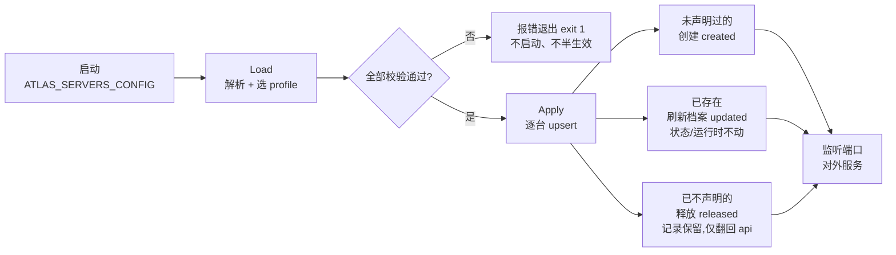

[English](server-config.md) | [简体中文](zh/server-config.md)

# Server Information Configuration

Server information (realm / shard / endpoint / capacity) previously had only one inbound path: the
game server calling the registration API `POST /v1/registry/servers/register`. Configuration-based
declaration provides a second path: **declare servers directly in a config file and Atlas picks
them up as soon as it starts** — no need to register once at the dashboard or the API first;
switching environment or server group = switching the config.

| Scenario | Which path |
| --- | --- |
| Static fleet, pre-provisioned server groups, environment migration | **Config declaration** (this page) |
| Dynamic instances, processes that frequently come up and go down | Registration API + heartbeat ([lifecycle.md](lifecycle.md) |

The two paths coexist and their fields correspond one-to-one; the boundaries and conflict behavior
are fully documented on this page.

## 1. Minimal Example: Bringing Up a Group of Servers from Config Alone

`servers.json` (flat structure, no grouping):

```json
{
  "servers": [
    {
      "server_id": "game-1001",
      "name": "Game 1001",
      "type": "game",
      "region": "cn-east",
      "realm_id": "realm-a",
      "shard_id": "shard-a1",
      "version": "1.0.0",
      "platform": "pc",
      "endpoint": { "host": "10.0.0.1", "port": 30001 },
      "capacity": 2000
    },
    {
      "server_id": "game-1002",
      "name": "Game 1002",
      "region": "cn-east",
      "endpoint": { "host": "10.0.0.2", "port": 30002 },
      "capacity": 2000
    }
  ]
}
```

Point to it at startup:

```bash
ATLAS_SERVERS_CONFIG=./servers.json ./atlas
```

Log confirming it took effect (three counters: created / updated / released):

```text
servers config applied file=./servers.json profile= declared=2 created=2 updated=0 released=0
```

The declared servers exist in storage immediately. The semantics match the registration API:
**not visible externally until the first heartbeat** (status `starting`; a patrol at 60s with no
heartbeat sets it to `offline`); once the instance starts its process, sending heartbeats as
usual brings it online and into the recommendation rotation:

```bash
curl -X POST localhost:8081/v1/registry/servers/game-1001/heartbeat \
  -H 'Content-Type: application/json' -d '{"players":42,"load":0.3}'
# {"server_id":"game-1001","status":"online","next_heartbeat_in":10}
```

The discovery and recommendation path is completely transparent to config-declared servers —
they are ordinary online servers:

```bash
curl localhost:8080/v1/discovery/servers
# game-1001/1002 online source=config 10.0.0.1:30001 ...
curl "localhost:8080/v1/routing/recommended?account_id=42&region=cn-east"
# {"server": {...}, "reason": "lowest_load"}
```

## 2. Multiple Environments / Multiple Server Groups: Profile Switching

One file declares multiple groups and one environment variable switches — **switching environment
= switching a profile value**:

```json
{
  "profile": "dev",
  "profiles": {
    "dev":  { "servers": [ { "server_id": "game-dev-1",  "...": "..." } ] },
    "prod": { "servers": [ { "server_id": "game-prod-1", "...": "..." },
                           { "server_id": "game-prod-2", "...": "..." } ] }
  }
}
```

| Switching method | Command |
| --- | --- |
| Run the dev group (the file's default) | `ATLAS_SERVERS_CONFIG=./servers.json ./atlas` |
| Run the prod group (switch with a single parameter) | `ATLAS_SERVERS_PROFILE=prod ATLAS_SERVERS_CONFIG=./servers.json ./atlas` |

Selection rules (highest to lowest):

1. The `ATLAS_SERVERS_PROFILE` environment variable — highest priority;
2. The file's own `"profile"` field;
3. The profile named `"default"` (if present);
4. None of the above — **fails at startup**, listing all available profile names.

One file per environment is also supported (without writing `profiles`): whichever file
`ATLAS_SERVERS_CONFIG` points to is that environment. In this form, setting
`ATLAS_SERVERS_PROFILE` errors out directly (there is nothing to select; it is not silently
ignored).

## 3. Effective Semantics and Precedence

Applied as a whole declaration set at startup; **the config takes precedence**, and the same
validation runs before anything is persisted:



- **The config takes precedence over already-registered records**: the same `server_id` both exists
  (registered via the API previously or declared last time) and appears in the config; the
  config's fields (name / region / realm / shard / endpoint / capacity, etc.) overwrite the old
  values.
- **Status and runtime data are never changed by the config**: `status`, `players`, `load`,
  `last_seen_at`, and the process start time are not written — restarting Atlas or switching
  profiles will not knock an online server back to `starting`.
- **The declaration set is the single source of truth for "config-managed"**: remove a server
  from the config and on the next startup that record is **released** back to API management
  (`source` flips back; the record and status are preserved as-is), after which the
  registration API can be used normally again. Deleting a declaration does not delete data.

Boundaries of each operation while under config management:

| Operation | Behavior | Notes |
| --- | --- | --- |
| Registration API (same ID) | ❌ **409** `SERVER_MANAGED_BY_CONFIG` | The record is owned by the config; API changes are overwritten at the next startup; the error message points you to change the config |
| Heartbeat | ✅ Normal | Runtime data belongs to the game server; a config-declared server in `suspect`/`offline` returns to rotation as soon as it heartbeats (config management cannot re-register; the heartbeat is the only credential) |
| Deregistration | ✅ Normal | Marks `offline` and clears runtime; the record is preserved and refreshed from config at the next startup |
| Admin lifecycle (maintenance / drain / disable) | ✅ Normal | Operations semantics are independent of the management mode |
| Registration API after removal from config | ✅ Returns 201 | Once released, it becomes an ordinary API server again |

## 4. Validation: Fail at Startup, Never Half-Applied

Any problem in the config file causes an error exit **before the listening port** (`exit 1`,
with the entry location and reason in the error); it will not skip bad entries and keep running:

| Check | Example error |
| --- | --- |
| File does not exist / JSON syntax error | `read servers config: no such file` |
| **Unknown field (misspelled)** | `json: unknown field "regoin"` |
| Both `profiles` and `servers` written | `use either "profiles" or "servers", not both` |
| Duplicate `server_id` | `server 1 (dup) duplicates server 0` |
| Missing `region` | `server 0 (bad-1): invalid argument: region is required` |
| Endpoint missing `host` / port out of range | `endpoint host is required` / `endpoint port must be within [1, 65535]` |
| `capacity` is negative | `capacity must be >= 0` |
| Multiple profiles but none selected | `profile not selected — set ATLAS_SERVERS_PROFILE to one of: dev, prod` |
| Selected profile does not exist | `profile "staging" not found (available: dev, prod)` |
| Flat file but a profile is set | `declares no profiles; ATLAS_SERVERS_PROFILE="dev" has nothing to select` |

The validation rules are identical to the registration API (`model.Server.Validate`); a field
that fails in the config fails the same way in the API.

## 5. Configuration Items

| Environment variable | Description | Default |
| --- | --- | --- |
| `ATLAS_SERVERS_CONFIG` | Path to the server declaration file (JSON). Empty = feature disabled; behavior is exactly as if this feature did not exist | `""` |
| `ATLAS_SERVERS_PROFILE` | Selects the active profile, overriding the file's own `"profile"` field | `""` |

The file fields correspond one-to-one with the registration API request body:

| Field | Required | Description |
| --- | --- | --- |
| `server_id` | ✅ | Globally unique; the same `server_id` as the registration API |
| `region` | ✅ | Region |
| `endpoint.host` / `endpoint.port` | ✅ | Client access address (public address or post-gateway address both work) |
| `name` / `type` / `version` / `platform` | — | Same as the registration API |
| `realm_id` / `shard_id` | — | Weak references to the Realm / Shard it belongs to (no foreign-key validation; see [realms-shards.md](realms-shards.md); stored normally even if it does not exist |
| `capacity` | — | Capacity, `>= 0` |
| `metadata` | — | Arbitrary key-value pairs, passed through into storage with the declaration (engine hints, cluster/region/language tags, etc.; same semantics as the registration API's `metadata`) |

Status (`starting`/`online`/`maintenance`/…) cannot be declared — when states such as maintenance /
disable need to be pre-set, use the Admin lifecycle interface after startup.
