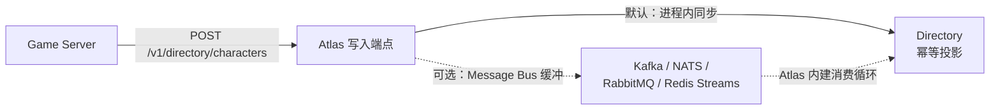
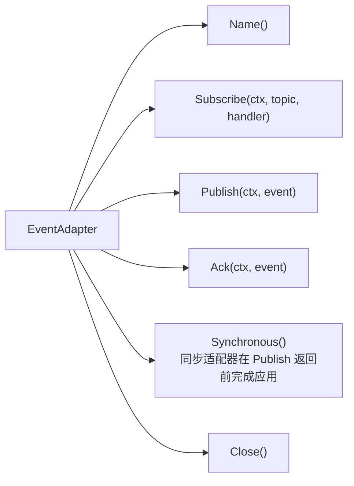
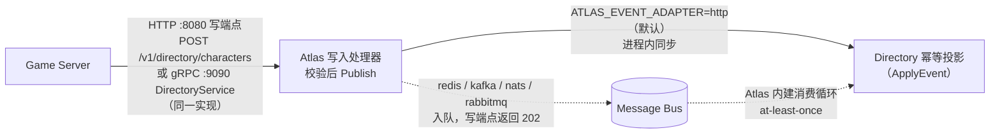
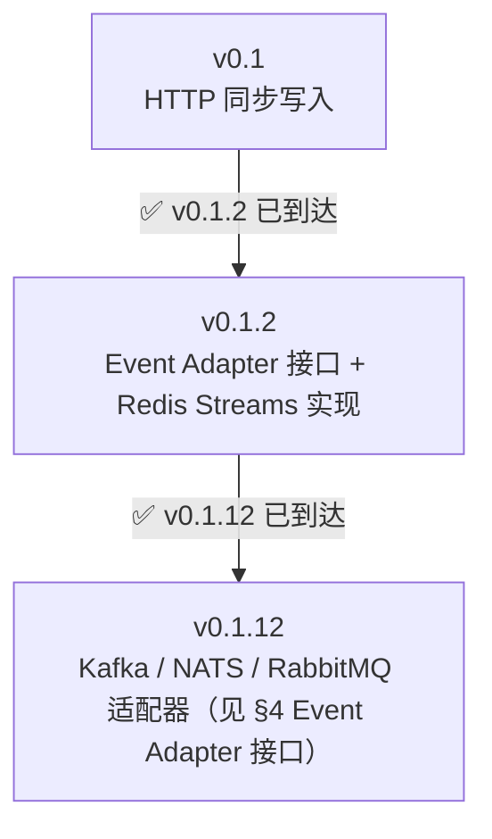
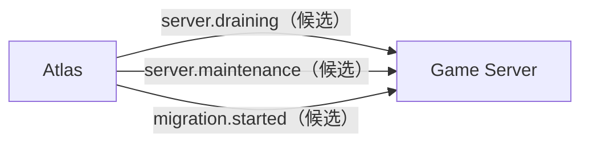

# Data Sync

How game character data enters Atlas's character index.

## 0. Usage Cheat Sheet: How to Choose, Configure, and Verify

**When you need a Message Bus** (for all other cases the default HTTP sync is fine; see
[Quick Start](/api-quickstart) §2):

- Character writes spike during server launches / merges and need **peak shaving buffering**;
- Character write volume is high enough that per-record REST calls become a burden on the game
  server hot path and need **asynchronous** handling;
- Game server writes must **not fail** during Atlas rolling restarts; you need fault isolation;
- The same character events also need to be fed to **other subscribers** such as risk control /
  data analytics.

**How to configure** — no code changes, one environment variable switches (connection details in
the §4 table):

```bash
ATLAS_EVENT_ADAPTER=redis  ./atlas                      # 复用已有 Redis，零新增组件
ATLAS_EVENT_ADAPTER=kafka  ATLAS_KAFKA_BROKERS=b1:9092,b2:9092 ./atlas
ATLAS_EVENT_ADAPTER=nats   ATLAS_NATS_URL=nats://nats:4222 ./atlas
ATLAS_EVENT_ADAPTER=rabbitmq ATLAS_RABBITMQ_URL=amqp://rabbit:5672/ ./atlas
```

**How to verify it is running** — when the write endpoint changes from "synchronous persistence"
to "queued", the adapter has taken over:

```bash
# 适配器为 http（默认）：201，响应里带投影结果
# 适配器为 redis/kafka/nats/rabbitmq：202 Accepted，{"status":"queued"}
curl -s -w '\n[%{http_code}]\n' -X POST http://localhost:8080/v1/directory/characters \
  -H 'Content-Type: application/json' \
  -d '{"account_id":10001,"server_id":"game-1001","character_id":9001,"name":"验证","level":1}'

# Redis 适配器：流里能看到事件、稍后角色可查即消费正常
redis-cli XLEN atlas.characters
curl http://localhost:8080/v1/directory/characters/9001
```

The consumption side is handled by Atlas's built-in consumer loop (no separate consumer process
needs to be deployed); delivery is at-least-once, persistence is idempotent (§6), and the
redelivery-on-failure semantics are described per adapter below the §4 table.

---

## 1. Core Principles

> **Do not have the Game Server call the Atlas API in a tightly coupled way every time it
> modifies a character.**

In implementation, "event-driven" applies to **the Atlas write interface internally**: the game
server still only calls `POST /v1/directory/characters` (the HTTP write endpoint; gRPC `:9090`
has a mirrored endpoint of the same name with the same implementation); eventization happens
after the Atlas write handler — synchronous persistence by default, and one environment variable
switches to Message Bus asynchronous buffering when peak shaving / fault isolation is needed:



The game server **never connects directly to the message queue**; both the producer and the
consumer of the queue are Atlas (see §5 Write Path for details).

---

## 2. Event Definitions

```json
{
  "event": "character.created",
  "account_id": 10001,
  "server_id": 1001,
  "character_id": 823712,
  "name": "剑无尘",
  "level": 1
}
```

| Event | Trigger timing | Carried fields | Current trigger source |
| --- | --- | --- | --- |
| `character.created` | Character created | Full index fields | Write endpoint `POST /v1/directory/characters` |
| `character.updated` | Level up / name change / class change | Changed fields | Write endpoint `PATCH /v1/directory/characters/{id}` |
| `character.deleted` | Character deleted | Primary key triple | Write endpoint `DELETE /v1/directory/characters/{id}` |
| `character.moved` | Server transfer | Primary key + `target_server` | **No built-in trigger source yet** (definition and consumption are ready; awaiting migration linkage / an eventized reverse channel) |
| `character.login` | Login | Primary key, used to refresh `last_login_at` | **No built-in trigger source yet** (same as above) |

> All five event types can be consumed by `ApplyEvent`; but the only trigger sources are the three
> write endpoints (created / updated / deleted). `moved` / `login` currently **have no code path
> that produces them** (reserved event definitions): the data transfer of a server transfer is
> performed by the game server and then updates the index via the write endpoint `PATCH` (which
> produces an `updated` event) — `moved` is not consumed. Do not assume from the event table that
> these two events appear automatically.

---

## 3. Why Events Instead of Synchronous Calls

| Dimension | Synchronous call | Event-driven |
| --- | --- | --- |
| **Coupling** | The game server strongly depends on Atlas availability | The game keeps running when Atlas is unavailable |
| **Performance** | Adds a network round trip to the character creation path | Asynchronous; does not block player operations |
| **Retry** | Each game server implements it itself | The Message Bus guarantees delivery |
| **Scaling** | Adding a subscriber requires changing the game server | Adding a subscriber does not change the producer |
| **Peak shaving** | None | Write spikes at server launch / merge are buffered |

The most critical is **fault isolation**: Atlas is the control plane; its availability should not
affect the game data plane. If Atlas is restarting while a player creates a character, it should
not fail.

---

## 4. Message Bus Selection

The first version supports multiple buses via the **Event Adapter** abstraction:

**Kafka / NATS / Redis Streams / RabbitMQ**

### Recommendation

| Scenario | Selection | Reason |
| --- | --- | --- |
| Small-to-medium scale | **Redis Streams** | Redis dependency already present, zero extra components |
| Large scale | **Kafka** | Persistence, replay, multiple consumer groups |
| Low latency | **NATS** | Lightweight, suitable for high-frequency events on an internal network |
| Traditional architecture | **RabbitMQ** | Mature routing and acknowledgment mechanisms |

### Event Adapter Interface



Atlas Core depends only on this interface, not on any concrete implementation. Switching the
Message Bus does not change business code.
Five implementations are built in, selected via `ATLAS_EVENT_ADAPTER`:

| Adapter | Value | Connection config | Semantics |
| --- | --- | --- | --- |
| In-process synchronous | `http` (default) | — | Events persist synchronously within the request, preserving v0.1 behavior; the response contains the projection result |
| Redis Streams | `redis` | `ATLAS_REDIS_URL` | `XADD` into the stream; the consumer group `atlas` consumes asynchronously via `XREADGROUP` and then `XACK`; the write endpoint returns 202 |
| Kafka | `kafka` | `ATLAS_KAFKA_BROKERS` (comma separated, default `localhost:9092`) | Writes to the topic `atlas.characters` (segmentio/kafka-go, pure Go); the consumer group `atlas` commits offsets manually |
| NATS | `nats` | `ATLAS_NATS_URL` (default `nats://localhost:4222`) | JetStream stream `ATLAS` (subject `atlas.characters`); the durable pull consumer `atlas` acks explicitly |
| RabbitMQ | `rabbitmq` | `ATLAS_RABBITMQ_URL` (default `amqp://localhost:5672/`) | Durable topic exchange `atlas`; queues named per topic; persistent messages + manual Ack |

All except `http` are at-least-once delivery, and events whose handling fails are redelivered:

- **redis**: Failed events stay in the PEL and are redelivered by `XAUTOCLAIM` after 30 seconds;
  after more than 5 deliveries they are logged as dead letter.
- **kafka**: The offset of a failed event is not committed; the next fetch/rebalance redelivers it.
- **nats**: Failed messages are not acked; after exceeding AckWait (default 30s) the durable
  consumer redelivers them.
- **rabbitmq**: Failed messages first back off by `requeueBackoff` (default 5s) and then are
  redelivered via `Nack(requeue=true)` — there is no delivery counter to cap retries, and the
  backoff sits on the consumer goroutine, incidentally throttling subsequent deliveries.

Therefore the consumer side must be idempotent — the upsert in `Directory.ApplyEvent` is
naturally idempotent (see §6).

Integration only requires changing one environment variable, e.g.:

```bash
ATLAS_EVENT_ADAPTER=kafka ATLAS_KAFKA_BROKERS=broker1:9092,broker2:9092 ./atlas
ATLAS_EVENT_ADAPTER=nats ATLAS_NATS_URL=nats://nats:4222 ./atlas
ATLAS_EVENT_ADAPTER=rabbitmq ATLAS_RABBITMQ_URL=amqp://rabbit:5672/ ./atlas
```

Switching adapters does not change the write endpoint's URL or request body (game servers and
SDKs need zero changes); only the response changes: `http` returns `201` + the projection result,
while the other four return `202 Accepted` (`{"status":"queued"}`). The consumption side is
handled by Atlas's built-in consumer loop, so no separate consumer process needs to be deployed.

For operations guidance beyond the §4 recommendation table: if Redis already exists use `redis`
(zero new components); for high-throughput logs/auditing that need replay and multiple consumer
groups use `kafka`; for cloud-native low-latency internal networks with multi-machine broadcast
use `nats`; if an AMQP operations stack already exists or complex routing is needed use
`rabbitmq`; for single-machine development / small-scale direct connection use `http`
(synchronous, the most intuitive behavior).

---

## 5. Write Path

**HTTP synchronous writes remain the default form, with the Event Adapter as a coexisting
decoupling entry point.**

The write interface is the only surface the game server touches (the HTTP write endpoint, mirrored
by gRPC under the same name); the queue segment (if enabled) is entirely inside Atlas — the write
handler is the producer and Atlas's built-in consumer loop (`Subscribe` in `main.go`) is the
consumer. **There is no need, and it is not recommended, to deploy a separate consumer process**:



The synchronous path's response is identical to v0.1; under the Redis path the write endpoint
returns `202 Accepted` (`{"status":"queued"}`) and the consumer group persists it asynchronously.

> The payloads in the broker (e.g. Redis's `{type, data}` stream entries, Kafka's event JSON) are
> **Atlas internal formats** and are not an external contract: external systems delivering directly
> to the broker is mechanically feasible (the consumer loop parses them as usual), but the fields
> carry no versioning commitment and upgrades may be incompatible — integration should always go
> through Atlas's write interface (the HTTP write endpoint or gRPC).

### Migration Path



The key is **designing the write interface to be idempotent from day one**, so that retries are
side-effect free no matter whether the underlying transport is HTTP or MQ.

---

## 6. Idempotency

Events can be redelivered (MQ's at-least-once semantics), so Atlas must be idempotent.

**Idempotency key = `(account_id, server_id, character_id)`**

```sql
INSERT INTO character_index (account_id, server_id, character_id, name, level, class_id)
VALUES (10001, 1001, 823712, '剑无尘', 1, 3)
ON CONFLICT (account_id, server_id, character_id)
DO UPDATE SET
    name      = EXCLUDED.name,
    level     = EXCLUDED.level,
    class_id  = EXCLUDED.class_id,
    updated_at = now();
```

`ON CONFLICT DO UPDATE` makes ordinary `character.created` redelivery idempotent. For
timestamped create/login events, a timestamp older than a projection already changed since
creation is ignored so `last_login_at` and the row do not move backwards.

### Out-of-order Handling

Events can arrive out of order (`updated` before `created`). Two handling strategies:

| Strategy | Approach | Applicable |
| --- | --- | --- |
| **Version number** | The event carries a monotonically increasing version; lower versions are discarded | Strong consistency requirements |
| **Eventual consistency** | Do not handle out-of-order; rely on the next event to overwrite | Recommended for MVP |

v0.1 uses **eventual consistency** for general event ordering, because the index fields are only
used for list display and a brief `level` lag is acceptable. Timestamped create/login replays have
a narrow `last_login_at` ordering guard; events without timestamps and other field updates still
have no source-version or sequence check.

---

## 7. Consistency Boundaries

What Atlas's character index guarantees:

| Guaranteed | Not guaranteed |
| --- | --- |
| Index integrity (all characters under an account are queryable) | Fields are real-time accurate |
| `character_id` is not lost | `level` / `name` are consistent to the second |
| Atomic switch for merge / transfer | Consistency of the character data itself |

**Index integrity > field real-time accuracy.** This is the design tradeoff of the projection table.

---

## 8. Reverse Sync (Design Direction, Not Implemented)

**The current version of Atlas does not push events to game servers.** When the direction is
reversed, the game servers perceive Atlas-side changes through:

| Change | Existing perception channel |
| --- | --- |
| Being judged `suspect` / `offline` | The heartbeat response's `status` field returns the effective status truthfully (v0.1.x patrol fix); the server can alert or re-register accordingly |
| Under maintenance / announcements | The player client pulls `GET /v1/discovery/announcements`; the server does not need to perceive it |
| Migration start | Operations notify the relevant servers via the migration API (`POST /v1/admin/migrations`); the game server cooperates with locking |

An eventized reverse channel (`server.draining` / `server.maintenance` / `migration.started`
pushes) is a candidate direction, not scheduled:



Until it lands, **do not** assume Atlas will actively notify game servers.

---

## 9. Monitoring

The event sync write path has a dedicated metric `atlas_directory_write_duration_seconds{op}`: op is
the projection event name (e.g. `character.created` normalized to `created` via `eventWriteOp`;
service-API writes appear as `create`/`update`/`delete`; see internal/directory/events.go:27 and
internal/directory/directory.go:38). Redeliveries and dead letters (redis's PEL overflow, kafka's
uncommitted offsets) are still visible in each adapter's structured logs. For overall service
health use the real metrics on `/metrics` (:8082):

| Metric | Meaning |
| --- | --- |
| `atlas_directory_characters_total` | Total character index size — if it keeps not growing, event consumption has stopped |
| `atlas_health_transitions_total{from,to}` | Lifecycle state transition volume |
| `atlas_registry_heartbeat_lag_seconds` | Heartbeat age distribution |
| `atlas_registry_servers_total{status}` | Server count per status |
| `atlas_registry_write_duration_seconds{op}` | Registration / heartbeat / deregistration write path latency — heartbeat writes slowing down shows up here first, followed by false suspect/offline |
| `atlas_directory_write_duration_seconds{op}` | Character directory write path latency; op is the event name (`created`/`updated`/`deleted`…) or the service-API operation name — event sync delay and event backlog show up here first |
| `atlas_discovery_requests_total{filter}` | Discovery query volume |
| `atlas_admin_requests_total{endpoint,status}` | Admin request volume (REST routes + gRPC Admin full method names, status codes in the same vocabulary) |

To troubleshoot index divergence: first check whether `atlas_directory_characters_total` has
stalled, then look at the redelivery / dead letter records in the adapter logs, and finally confirm
that the bus (broker) itself is reachable.
