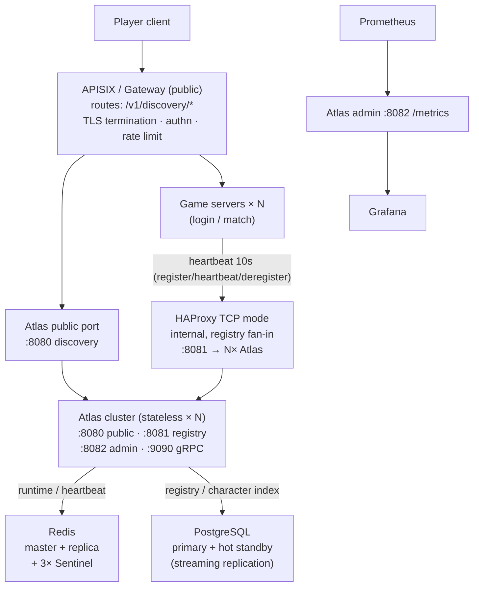

# Deployment Topology (v0.1.20)

The complete deployment view from client to storage. Ports, responsibilities and
traffic directions map one to one; for high-availability details (replicas, sentinels,
primary/replica) see [ha.md](ha.md), and for the state machine see
[lifecycle.md](lifecycle.md).

## 1. Layered responsibilities

| Layer | Component | Responsibility | Notes |
| --- | --- | --- | --- |
| Ingress | APISIX (or a gateway) | TLS termination, player-side authn, rate limiting, routing for `/v1/discovery/*` | The only public entry point; discovery endpoints are read-only, so they can be cached aggressively |
| Ingress | HAProxy TCP mode | Fan game-server heartbeats in to the Atlas registry port | Pure layer-4 passthrough; the registry has its own tokens / mTLS (v0.1.17) |
| Service | Atlas public `:8080` | Discovery / Routing (read-only) + Directory (character index reads **and writes**) + cross-server config pull | Stateless, scales horizontally; the Directory write endpoint is also on this port |
| Service | Atlas registry `:8081` | Register / heartbeat / deregister (writes) + cross-server config pull | Heartbeat 3:1:6 pacing (lifecycle.md §4.2); config pull is served on both this and :8080 |
| Service | Atlas admin `:8082` | Lifecycle operations, stats, maintenance windows, announcements | Internal / management network; RBAC + audit + rate limiting |
| Service | Atlas gRPC `:9090` | A high-performance internal channel equivalent to the HTTP one | Optional for game servers to connect directly |
| Storage | Redis | Runtime data: heartbeats, player counts, load (TTL ≤ 120s) | Sentinel failover; Atlas only does key-value reads and writes |
| Storage | PostgreSQL | Registry, character index projections, migrations, realm/shard, maintenance windows, announcements | Primary/replica streaming replication; a single write point |
| Observability | Prometheus / Grafana | Metric scraping and health dashboards | `GET /metrics`; for the alert webhook see lifecycle.md §4.1 |
| Management | Dashboard | Operations console (React) | Connects straight to the admin port, or is proxied through the gateway |

## 2. Traffic directions and port matrix

| Source → Target | Port | Protocol | Security |
| --- | --- | --- | --- |
| Player → APISIX | 443 | HTTPS | Gateway authn + rate limiting |
| APISIX → Atlas | 8080 | HTTP | Internal / mTLS optional |
| Game server → HAProxy → Atlas | 8081 | HTTP | `ATLAS_REGISTRY_TOKENS`; for upgrading to mTLS see security.md |
| Operations / Dashboard → Atlas | 8082 | HTTP | `ATLAS_ADMIN_API_KEYS` + RBAC + audit + rate limiting |
| Internal service → Atlas | 9090 | gRPC | Internal |
| Atlas → Redis | 6379 / 26379 | RESP | `requirepass`, sentinel topology (ha.md §3) |
| Atlas → PostgreSQL | 5432 | TCP | scram-sha-256, pool tuning (ha.md §5) |
| Prometheus → Atlas | 8082/metrics | HTTP | Internal (admin port; subject to the same key authn when `ATLAS_ADMIN_API_KEYS` is configured) |

## 3. Deployment shapes

**Single node (development / validation)**: one Atlas process (`ATLAS_STORE=memory`) plus
the game servers, with no external dependencies.

**Standard production (recommended starting point)**:

- Atlas × 2 (in different availability zones), HAProxy fanning in to the registry,
  APISIX facing the public internet;
- PostgreSQL primary + hot standby (streaming replication);
- Redis master + replica + 3 Sentinel;
- Prometheus + Grafana + an alerting channel via `ATLAS_ALERT_WEBHOOK_URL`.

**Large scale**: shard the character index (`ATLAS_CHAR_SHARDS` > 1, data-model.md §5),
swap the event adapter for Kafka / NATS (sync.md §4), and make the admin side sticky
single-replica (the audit ring is per-replica, ha.md §1).

One-command lab stack (2× Atlas + HAProxy + PG primary/replica + Redis Sentinel):
`deploy/docker-compose.ha.yaml`.
